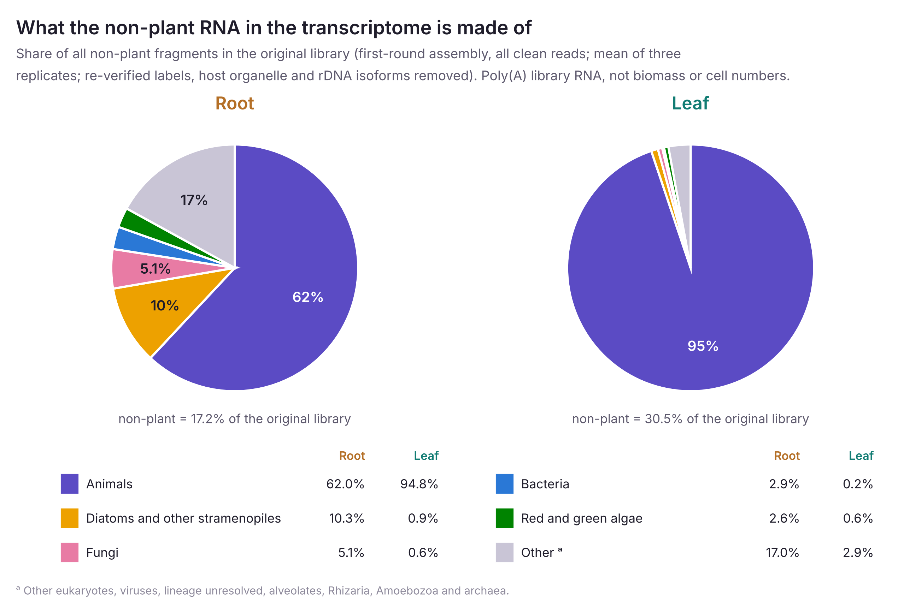
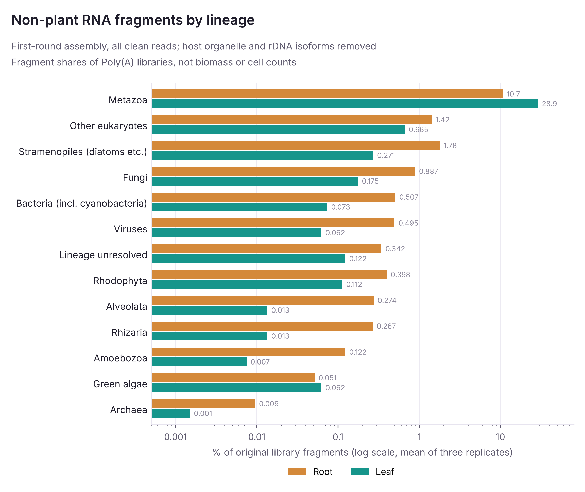
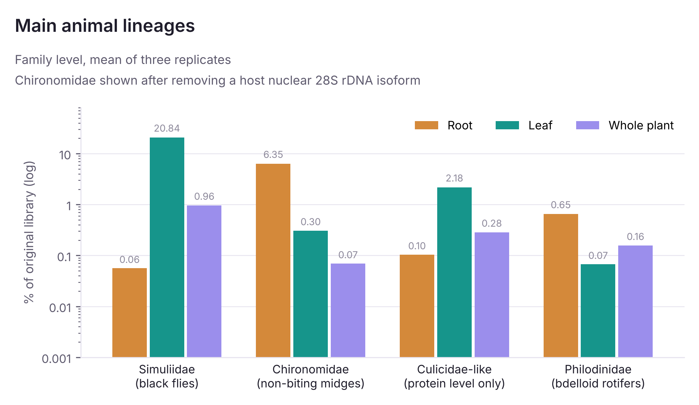
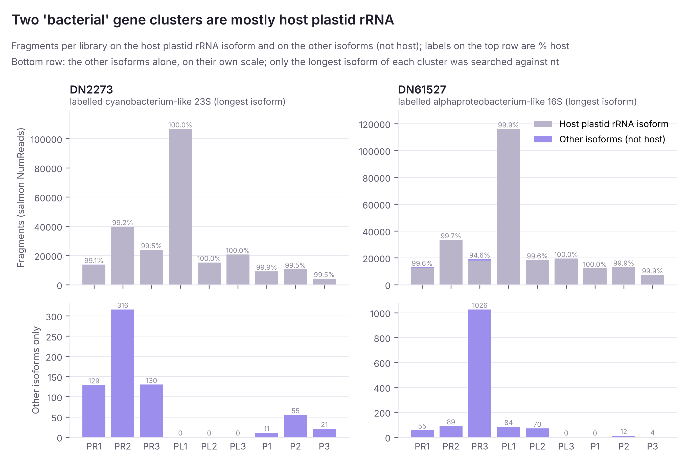
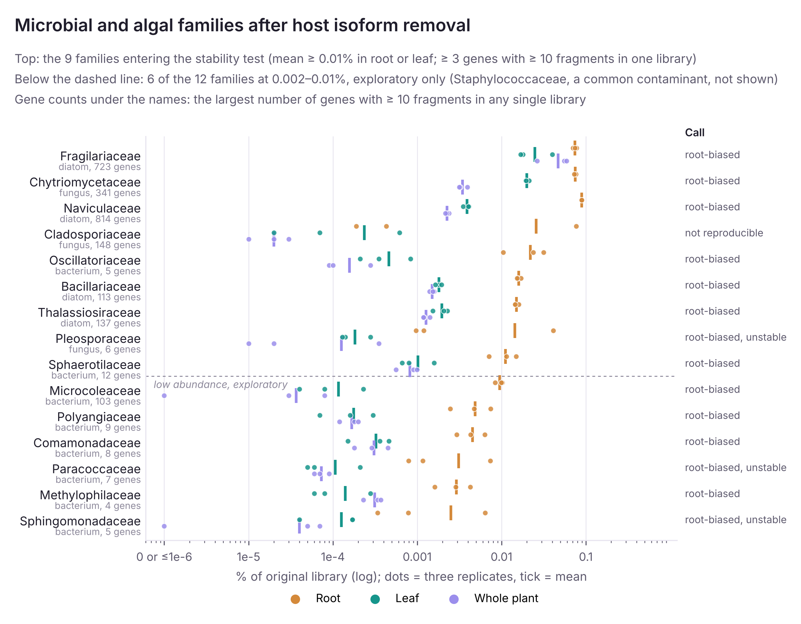
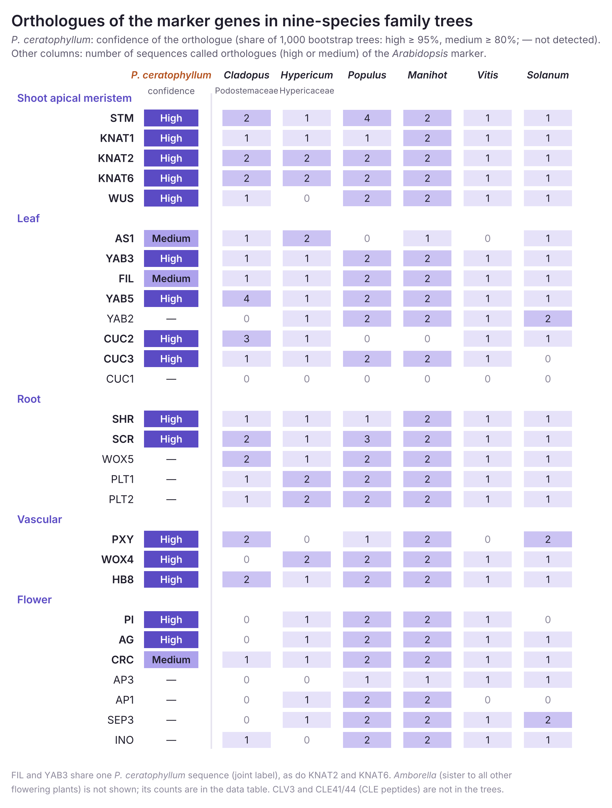
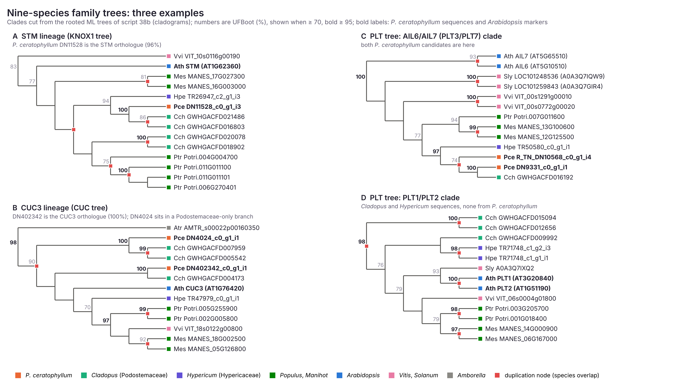
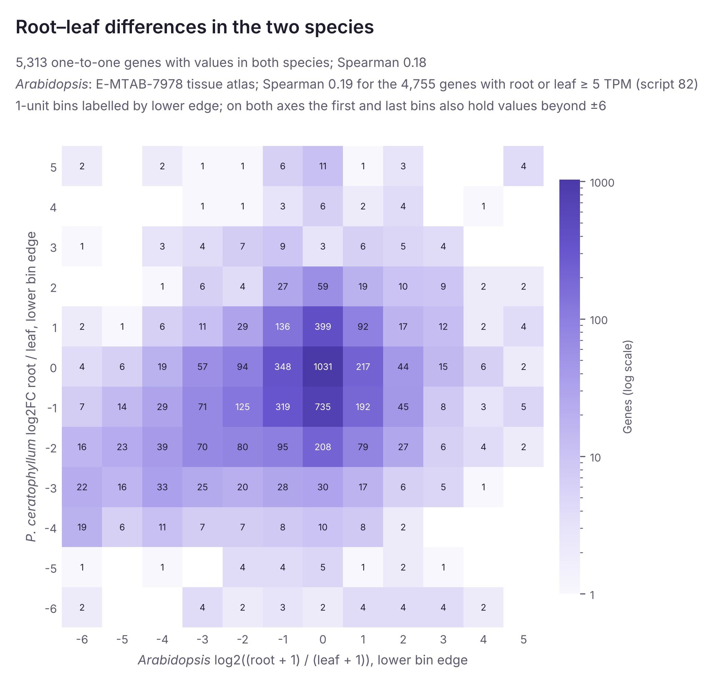
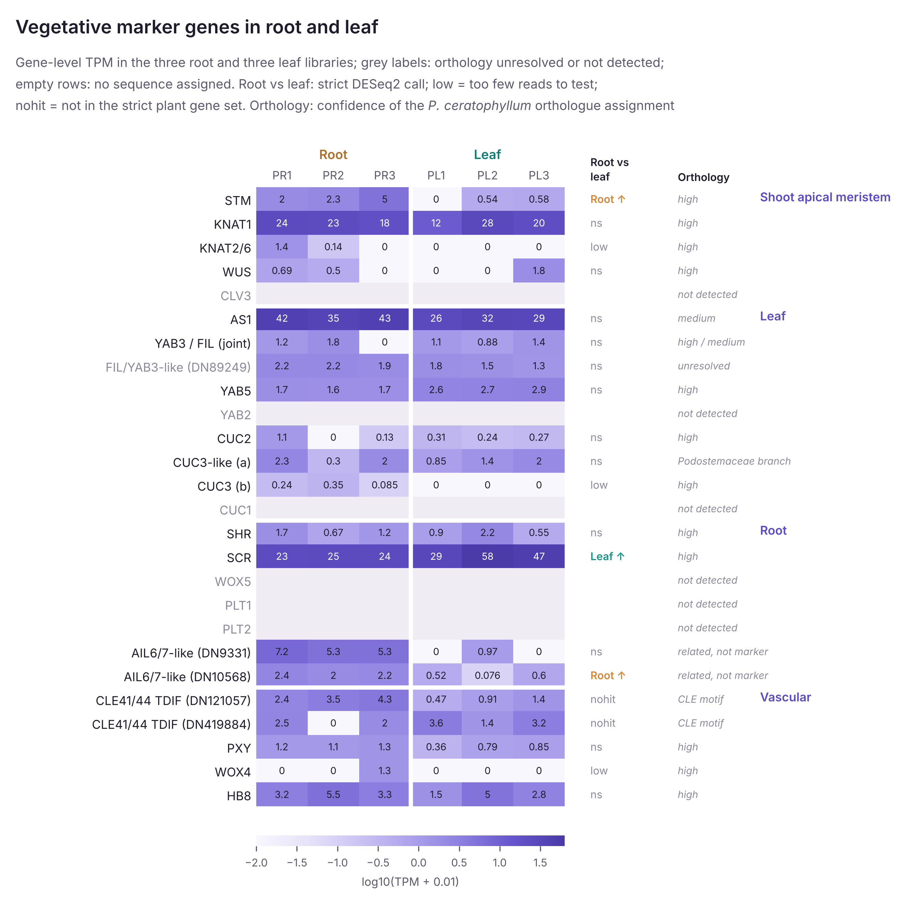
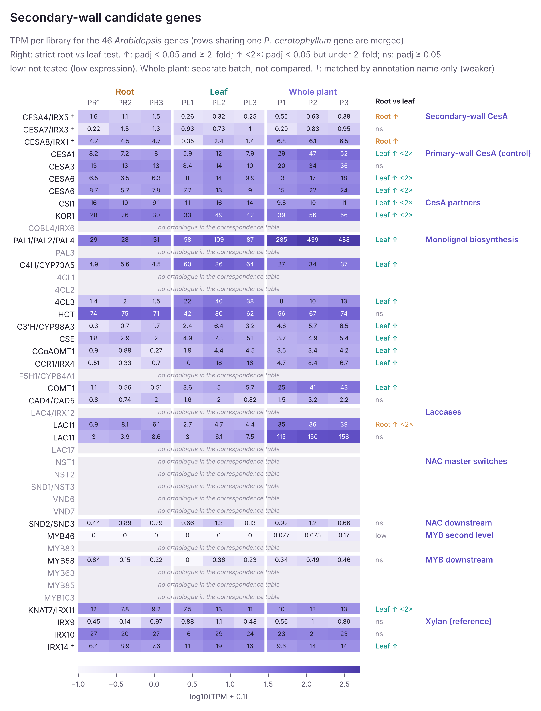

# Progress Results of the <i>Podostemum ceratophyllum</i> Transcriptome Analysis

Screening of associated-organism sequences, orthology with <i>Arabidopsis</i>, and root–leaf expression differences

Keguang Cheng · Zumajo lab

October 29, 2026

<!--
Terms: Root = PR1–3; Leaf = PL1–3, meaning all plant parts remaining after root removal. The three unsplit whole-plant libraries (P1–3, another sequencing run) went into the assembly and are not used in any comparison; every comparison, table and figure uses root and leaf, and the few pooled values that still include the whole plant say so on the slide.
-->

---
layout: page
class: lg
kicker: Overview
source: Table 1; 5.1, Table 99
---

# Current results at a glance

The main computations are complete; identification ranks of bacteria, fungi and algae and the “unknown” sequences have been re-verified in targeted analyses.

| | Analysis | Result |
|---|---|---|
| 1 | Remove associated-organism reads before assembly and build the formal reference transcriptome | Retention check of key markers and read-set sensitivity check completed |
| 2 | Identify the sources of non-plant reads | Mainly animals, plus bacteria, fungi and several algal groups; high-fragment sequences re-verified one by one for the reportable rank |
| 3 | Proteome-wide correspondence with *Arabidopsis*; nine-species family trees of the marker genes | Correspondence table; orthologues of 28 markers rechecked in nine species; root–leaf expression differences |
| 4 | Targeted analyses of “unknown” sequences and the secondary cell wall | Estimated host share of “unknown” sequences; expression of preselected secondary-wall genes |

S1–S15 at the top right refer to sections of the Supplementary Data; “Source” at the bottom gives section and table numbers in the Comprehensive Experimental Record Report (the Report); [numbers] are references, listed on slides 38–40.

---
layout: page
class: lg
kicker: Sampling and data
supp: S1
source: 4.1.1–4.1.2, Tables 2–3; 4.2.1, Table 5
---

# Sampling: root and leaf split from the same plants

<b>Method</b>Poly(A) mRNA libraries, Illumina NovaSeq X Plus PE150; raw-read QC with fastp 1.1.0, FastQC 0.12.1 and MultiQC.

Root and leaf were split from the same plants and sequenced in one run; all comparisons in these slides use these six libraries.

| Fraction | Sampled material | Libraries | Limits in comparisons |
|---|---|---:|---|
| Root PR1–3 | Root part of the plant | 3 | Split from the same plants as leaf; pairing and independent sampling units to be confirmed |
| Leaf PL1–3 | All parts of the same plant remaining after root removal | 3 | Includes all non-root structures; not pure leaf blades |

- The root–leaf test currently uses six libraries with the model ~ tissue, without same-plant pairing.
- A paired test will follow once the PR–PL correspondence and the independent sampling units are confirmed; heatmaps group libraries by tissue and do not treat PR1–PL1 etc. as confirmed pairs.
- Three unsplit whole-plant libraries (another sequencing run) went into the assembly but are not compared, because group and sequencing batch would be completely confounded [32]; the few pooled values that still include them are marked.

SEQUENCING RUN AND READ FEATURES

Root and leaf were sequenced in the same run (LH01101 run 29).

<table class="tight fs12">
<thead><tr><th></th><th class="num">Root</th><th class="num">Leaf</th></tr></thead>
<tbody>
<tr><td>Mean GC</td><td class="num">47.50–48.13%</td><td class="num">44.35–45.41%</td></tr>
<tr><td>Duplication</td><td class="num">74.80–79.25%</td><td class="num">70.71–78.43%</td></tr>
</tbody>
</table>

The lower GC of leaf mainly reflects a larger load of low-GC associated RNA, in leaf mostly animal rRNA such as that of Simuliidae (Report 4.2.2).

<!--
Terms and scope:
- "Leaf" means all plant parts remaining after root removal. It keeps the original sample name Leaf and is not finely separated leaf blade.
- The whole plant was sequenced without separating root from the rest, in another run (LH00973 run 41). Its libraries went into the assembly and are not compared.
- The sampling records do not yet confirm which PR library pairs with which PL library, or whether the three replicates come from three independent plants; the analysis does not pair libraries by number.
-->

---
layout: page
class: lg
kicker: Sampling and data
supp: S1
source: 4.2.4–4.2.5, Tables 12, 14; 4.2.7, Table 17; 4.2.10, Tables 22–24; 4.4.4, Table 43; 4.4.10, Tables 63–64
---

# Source screening: associated reads removed, plant signal stable

<b>Method</b>Rcorrector 1.0.7 and Trimmomatic 0.39; reads labelled on a first-round assembly (DIAMOND vs NR, BLASTN vs nt) and by Kraken 2, host reads rescued; Trinity 2.15.2; BUSCO 5.8.3.

Most associated-organism reads were removed before assembly; the plant fragment share and the key expression results were not affected.

<PairBars title="Non-plant fragments in the original library (same method; three libraries pooled)" a-name="Before screening" b-name="After screening" :label-width="96" :rows="[{label:'Leaf',sw:'l',a:30.95,b:1.18},{label:'Root',sw:'r',a:17.79,b:4.53}]" />

- Reads removed: about 18% of all clean reads in root and 31% in leaf.
- With the labels of the three assembly versions unified, the formal assembly gives root 3.94% and leaf 1.10%.
- The plant fragment share of the original library barely changes with screening (root 65.0 / 65.1%, leaf 58.5 / 60.4%); what was removed is essentially the non-plant part.

99.6%of strict differential expression calls agree when all clean reads are used for quantification

27marker genes with unchanged read counts

89.9%BUSCO completeness of the formal assembly unigenes (91.4% over all isoforms) [3]

- Of the 56 genes whose call changed, 46 gained reads from screened-out associated reads (fungus-, diatom-, green-alga- or animal-like reads mis-mapped to plant homologs); 8 had no removed reads, the change coming from normalization; 2 involved only ambiguous reads.

<!--
BUSCO 89.9% is the share of conserved genes in the test set that are found complete; it does not mean that 89.9% of genes were detected. Consistent results from different algorithms on the same data are not independent validation.
-->

---
layout: figpage
kicker: Associated sources · composition
supp: S2
source: 4.5.8, Table 95; Supplementary Data S2
side: right
figw: 700px
---

# What the non-plant RNA in the transcriptome is made of

<b>Method</b>Salmon fragments on the first-round assembly (all clean reads); gene sources from NR / nt best hits and their common ancestor; 386 genes carrying most fragments of each group re-verified one by one; host isoforms deducted.

Non-plant fragments are 17.2% of the root and 30.5% of the leaf original library. Animals make up 62% of them in root and 95% in leaf.

- **Root**: besides animals (mainly Chironomidae), diatoms and other stramenopiles are 10.3% of the non-plant fragments, fungi 5.1%, bacteria 2.9% and red and green algae 2.6%; the remaining 17.0% are mainly other eukaryotes, viruses and unresolved lineages (footnote a in the figure).
- **Leaf**: almost all non-plant RNA is animal, mainly Simuliidae (black flies, 20.8% of the leaf library).
- Bacteria, fungi and algae (including diatoms) together are 21% of the non-plant fragments in root (3.6% of the library) and 2.3% in leaf (0.7% of the library).
- These are shares of Poly(A) library RNA, not biomass or cell numbers; the next slide gives all thirteen major groups.

::fig::

<!--
Right, fig22_nonplant_pie: share of each class in all non-plant fragments, root and leaf (data in fig22_nonplant_pie_data.tsv; values from Report Table 95 and Supplementary Data S2, the same values as fig05).
"Other" is other eukaryotes, viruses, lineage unresolved, alveolates, Rhizaria, Amoebozoa and archaea. Red and green algae are merged so that the pie has six parts.
-->
---
layout: figpage
kicker: Associated sources · composition
supp: S2
source: 4.5.1, Table 68 (original labels); 4.5.8, Table 95; re-verified values of all major groups in Supplementary Data S2
side: right
figw: 540px
---

# Sources of non-plant RNA fragments

<b>Method</b>Salmon fragments per gene on the first-round assembly (all clean reads); labels re-verified with nt and rRNA databases; host isoforms deducted.

Non-plant fragments are mainly animal; the five bacterial, fungal and algal major groups make up about 3.63% of the root original library, and most are higher in root.

% of original library (mean of three replicates; re-verified labels)

| Major group | Root | Leaf |
|---|---:|---:|
| Animals (Metazoa) | 10.67 | 28.94 |
| Stramenopiles (incl. diatoms) | 1.782 | 0.271 |
| Fungi | 0.887 | 0.175 |
| Bacteria (incl. cyanobacteria) | 0.507 | 0.073 |
| Red algae ᵇ | 0.398 | 0.112 |
| Green algae etc. | 0.051 | 0.062 |
| Other ᵃ | 2.93 | 0.88 |
| **Non-plant total** | **17.23** | **30.51** |

ᵃ Other eukaryotes 1.42 / 0.66, viruses 0.49 / 0.06, lineage unresolved, alveolates, Rhizaria, Amoebozoa, archaea. ᵇ Includes DN7210 (slide 14). The five bacterial, fungal and algal groups together: root 3.626%, leaf 0.693% (archaea and other eukaryotes excluded).

DEFINITIONS
<ul>
<li>Shares of RNA fragments in Poly(A) libraries, not cell numbers, biomass or community abundance; Poly(A) selection misses most bacterial RNA. Stramenopiles are not all diatoms.</li>
</ul>

::fig::

<!--
Right, fig05_group_composition: thirteen non-plant major groups in root and leaf, % of original library (log scale), with host isoforms deducted.
Report Table 95 lists the three major groups changed by isoform-based deduction (Metazoa, bacteria, red algae); re-verified shares of the other major groups are in Supplementary Data S2.
-->

---
layout: page
class: lg
kicker: Associated sources · composition
supp: S2
source: 4.5.2, Tables 70–72; 4.5.8, Tables 94–95
---

# Non-plant RNA fragments: changes across three label versions

<b>Method</b>V0 protein labels (DIAMOND vs NR) → V1 nt revision (megablast; common ancestor, identity-capped ranks) → sequence-by-sequence re-verification and isoform deduction.

Changes in the totals across the three label versions are concentrated in a few high-fragment sequences (the original labels of script 84 sum to root 17.81% and leaf 30.91%; mean of three replicates).

- An rRNA-like sequence first labelled fungal is a bdelloid rotifer (Philodinidae, animal), about 0.28 / 0.03% (root / leaf); script 88 moved several more fungal labels to other eukaryotes or stramenopiles (one to Bacillariophyceae). Fungi in root fell from 1.225% to 0.887%.
- A sequence first labelled fungal is a grass (Poaceae, a non-host plant), about 0.036% in root (almost all PR3) and near 0 in leaf, and was removed from non-plant; script 88 also removed three green-alga-labelled embryophyte sequences (together root 0.001%, leaf 0.003%).
- A sequence first labelled stramenopile and moved to red algae by script 86 (closest reference *Palmaria*, 93%) has 97–99.9% of its fragments on host plastid rRNA isoforms and is recorded as host; leaf red algae fell by about 0.11 percentage points.
- DN7210, an 18S sequence first labelled alveolate and placed only in Eukaryota by script 86 (closest reference <i>Audouinella</i>, 90.4%), was reassigned on 2026-10-28 to red algae (Florideophyceae) from the common ancestor of named references; root 0.076%, leaf 0.067% (slide 14).
- A sequence first labelled other eukaryote is a mite (animal), about 0.05% in leaf.
- Viruses, Rhizaria and Amoebozoa are unchanged; the rise in animals comes mainly from the rotifer and mite reassignments.

HOST FRAGMENTS DEDUCTED BY ISOFORM

All 275,497 isoforms of non-plant genes were compared with host organelle and nuclear rDNA references; only 5 met the host standard, one in each of 5 gene clusters. Four carry many fragments: two “bacteria” (DN61527, DN2273; slide 9), the Chironomidae 28S cluster DN2745 (slide 8) and the “red alga” cluster DN22134; the fifth is a trace sequence with a bacterial label.

% of original library; the table on slide 6 shows values after deduction

<table class="tight">
<thead><tr><th></th><th class="num">Root</th><th class="num">Leaf</th></tr></thead>
<tbody>
<tr><td>Host-isoform fragments of the 5 clusters</td><td class="num">0.55</td><td class="num">0.40</td></tr>
<tr><td>Before deduction: non-plant total</td><td class="num">17.77</td><td class="num">30.91</td></tr>
<tr><td>Before deduction: bacteria</td><td class="num">0.635</td><td class="num">0.331</td></tr>
<tr><td>Before deduction: red algae (incl. DN7210)</td><td class="num">0.483</td><td class="num">0.220</td></tr>
</tbody>
</table>

---
layout: figpage
kicker: Associated sources · animals
supp: S2
source: 4.5.2, Tables 71–72; 4.5.8, Table 94
side: right
figw: 620px
---

# Animal sources at a glance

<b>Method</b>Mitochondrial and rRNA marker genes vs nt (megablast); common ancestor of hits within 1%; ranks capped by identity (genus 97%, family 90%, order 85%).

Animals account for most non-plant fragments; this round focuses on bacteria, fungi and algae, so for animals only family-level composition is reported.

% of original library, mean of three replicates; after nucleotide-based taxonomic revision and isoform-based deduction of host fragments

| Taxon | Root | Leaf |
|---|---:|---:|
| Simuliidae (black flies) | 0.06 | 20.84 |
| Chironomidae (non-biting midges) | 6.35 | 0.30 |
| Culicidae-like (not confirmed by nucleotide evidence) | 0.10 | 2.18 |
| Philodinidae (bdelloid rotifers) | 0.65 | 0.07 |

- *P. ceratophyllum* is a foundation species of eastern North American rivers and provides extensive habitat for invertebrates and fish [1, 2].
- The Chironomidae share excludes the fragments of the host nuclear rDNA isoform in gene cluster DN2745.
- These shares describe only the sources of library RNA; they say nothing about genus or species, numbers of individuals or relationships with the plant.

::fig::

---
layout: figpage
kicker: Associated sources · bacteria
supp: S3
source: 4.5.8, Tables 91–92, 94
side: right
figw: 770px
class: t21
---

# Bacteria: the two largest “bacterial” gene clusters are host plastid rRNA; the remaining bacterial signal is low

<b>Method</b>All isoforms vs host plastid, mitochondrial and rDNA references (host if a ≥ 97% segment covers ≥ half the isoform); per-isoform Salmon fragments in each library.

About 40% of the original bacterial fragments over root and leaf (root about 20%, leaf about 78%) came from two rRNA-like gene clusters, which split by isoform into more than 98% host plastid rRNA. After deduction, bacteria are about 0.51% of the original library in root and 0.07% in leaf. The remaining bacterial signal is low: about 40% has no assigned phylum, the sequences re-verified to family or genus are mainly cyanobacteria and β- and α-proteobacteria, and the main taxa meeting the tissue-association criterion are root-biased.

86 bacterial genes were re-verified, covering 58% of the root + leaf fragments of this major group before deduction; rank proportions below use only the re-verified part as denominator. The two clusters with the most fragments:

| Gene cluster | Host plastid isoform | Share of gene fragments |
|---|---|---|
| **DN61527** | i9 (471 bp), 100% identity over full length | root 98.2%, leaf 99.9% |
| **DN2273** | i2 (476 bp), 99.2% identity, 99% coverage | root 99.3%, leaf 100% |

Four lines of evidence for the two clusters, and the cause: slide 10.

::fig::

<!--
Right, fig07_isoform_split: fragments per isoform of the two gene clusters in the three root and three leaf libraries. Top: the host plastid isoform stacked with the other (non-host) isoforms; bottom: the other isoforms alone. The bacteria-like evidence comes only from the longest isoform of each cluster.
Note: Poly(A) library preparation misses most bacterial mRNA, so the bacterial signal here is mostly rRNA-like sequence; low-abundance taxa show only that related fragments were detected and are root-biased. The species name of the best database reference does not mean that the species is present in the material.
-->

---
layout: page
kicker: Associated sources · bacteria
supp: S3
source: 4.5.1, Table 69; 4.5.8, Tables 92, 94
---

# Bacteria: evidence and cause for the two mixed gene clusters

<b>Method</b>nt and NCBI 16S / LSU rRNA databases (megablast, dc-megablast) and host references; per-isoform Salmon fragments.

### DN61527

Revision table: Methylobacteriaceae (protein level of script 84 only to Pseudomonadota) · gene level root 0.059%, leaf 0.134%

- **Evidence**: nt best hit *M. radiotolerans* 16S, 94.2%, full length; 16S-specific database best hit *Rubellimicrobium roseum*, 98.7%, but covering only 68%; host mitochondrion best 79%
- **Split**: isoform i9 (471 bp) is 100% identical to the host plastid over its full length and carries root 98.2% and leaf 99.9% of the gene’s fragments
- **Handling**: fragments of the host plastid 16S rRNA isoform are deducted from the bacterial share. The other 6 isoforms are not host and have very few fragments: root libraries 55 / 89 / 1,026 (the 1,021 in PR3 from i1), leaf 84 / 70 / 0; root mean about 0.001%, single-library maximum about 0.003%. Only the longest, i2, was aligned (alphaproteobacterial 16S-like; the two databases disagree at order, no genus), and it has 17 fragments, all in PL1

### DN2273

Original label Chamaesiphonaceae (<i>Chamaesiphon</i>-like, nt 23S 89.7%) · gene level root 0.070%, leaf 0.124%

- **Evidence**: nt best hit *Chamaesiphon minutus* 23S, 89.7%, full length; LSU-specific database best hit *Geitlerinema*, 83.9%; host mitochondrion best 87.3%
- **Split**: isoform i2 (476 bp) has 99.2% identity and 99% coverage to the host plastid and carries root 99.3% and leaf 100% of the gene’s fragments
- **Handling**: fragments of the host plastid 23S rRNA isoform are deducted from the bacterial share. The longest non-host isoform (cyanobacterial 23S-like) reaches order (Gomontiellales) by nt, with fragments below 0.001% of the original library

### Why whole clusters were counted as bacteria

- At gene level both are higher in leaf than in root, consistent in direction with host plastid rRNA being more abundant in green parts. Script 84 set gene labels from the longest transcript, which here was the bacteria-like isoform, so the fragments of the whole cluster were counted as bacteria; the host organelle rule of script 88 also aligned only the longest transcript and missed this.
- Host plastid 16S / 23S rRNA and bacterial rRNA share conserved regions (plastids derive from cyanobacteria), so Trinity grouped fragments of both into one gene cluster.
- In the scan of all 275,497 isoforms of non-plant genes, only these two and one trace sequence (DN231461, 0.001%) among bacteria contain host isoforms.

<!--
Split by isoform (alignments of script 87 and salmon fragment counts per library; Report Table 92):
- DN61527: fragments of i9 in the three leaf libraries are 115,926 / 18,269 / 19,457; the other 6 non-host isoforms together have root 55 / 89 / 1,026 and leaf 84 / 70 / 0 fragments.
- DN2273: the other 5 non-host isoforms together have root 129 / 316 / 130 fragments and leaf 0.
-->

---
layout: page
class: lg
kicker: Associated sources · bacteria
supp: S3
source: 4.5.8, Tables 91, 93; Appendix B, Table 102
---

# Bacteria: re-verification coverage and reportable low-abundance taxa

<b>Method</b>nt, NCBI rRNA databases and NR (DIAMOND) for each gene; common ancestor of hits within 1%, environmental sequences removed; replicate CV and root/leaf ratio.

### Coverage and reassignment

- After host-isoform fragments are deducted, the 86 re-verified genes cover 29.6% of the remaining bacterial fragments; within the re-verified part, ranks are major group 31%, family 26%, order 24% and genus 15%, mostly from rRNA-like sequences. The listed ranks add up to about 96%; the rest has no listed rank.
- Reassigned in re-verification: 3 bacterial labels, of which 1 rRNA-like sequence became red alga (Florideophyceae, 99.7%), 1 reached only other eukaryotes and 1 became a fungus (*Malassezia*); in addition, rRNA-like sequences with 2 stramenopile labels and 1 red-alga label became Cyanophyceae (85–89%).

### Replicate stability

- By the criteria on slide 26, Oscillatoriaceae and Sphaerotilaceae are tissue-associated (root-biased). Microcoleaceae and 10 other low-abundance bacterial families (including Staphylococcaceae, treated as a common contaminant; 10 without it) are exploratory only and all root-biased; Sphingomonadaceae and Paracoccaceae are unstable across root replicates.

### Bacteria assignable to family or genus

% of original library

| Taxon | Entries | Root | Leaf |
|---|---:|---:|---:|
| Oscillatoriaceae, *Phormidium* candidate | 1 | 0.0149 | 0.0004 |
| Oscillatoriaceae, genus undetermined | 2 | 0.0070 | 0.0001 |
| Both Oscillatoriaceae rows | | ~0.0219 | 0.0005 |
| Sphaerotilaceae | 5 | 0.0109 | 0.0009 |
| Hapalosiphonaceae | 1 | 0.0054 | 0.0002 |

- The other main taxa listed are below about 0.006% in root. Low-share signals of *Staphylococcus* and *Pseudomonas* are of common environmental or human origin and are not listed as stable associated taxa.
- One Nitrospiraceae sequence was re-verified to family, with near-zero fragments; its functional clue is on slide 15.

---
layout: page
kicker: Associated sources · fungi
supp: S4
source: 4.5.1, Table 69; 4.5.3, Table 76; 4.5.8, Tables 91, 93; Appendix B, Table 102
---

# Fungi: chytrid-related signal root-biased and stable; other candidates reported by rank

<b>Method</b>Same re-verification with 18S / 28S / ITS databases; family threshold protein ≥ 80% or nucleotide ≥ 90%; replicate CV within root and within leaf.

The chytrid-related signal that reaches the family threshold is higher in root and stable across replicates within root and within leaf; in the re-verified part, about half of the fungal fragments support only the major group Fungi.

60 fungal genes were re-verified, covering 32.5% of the group’s root + leaf fragments. Within them: major group 50%, family 16%, genus 11%, class 9%, order 6%, and about 8% moved to other eukaryotes or stramenopiles (re-verified part only, not all fungal fragments).

### Chytrid-related Chytriomycetaceae: two definitions (% of original library)

| Definition | Genes ᵃ | Root | Leaf |
|---|---:|---:|---:|
| Sum over revision-table (V1) labels (script 87) | 2,782 | 0.261 | 0.068 |
| Evidence at the family threshold (protein ≥ 80% or nucleotide ≥ 90%) | 341 | 0.075 | 0.020 |

ᵃ Both rows count all nine sequenced libraries, whole plant included. Row 1: genes with ≥ 10 fragments in any library; row 2: the most genes with ≥ 10 fragments in any one library (stability criterion). At the family threshold, replicate CV is 0.02 in root and 0.05 in leaf: tissue-associated (root-biased). None of the 23 re-verified Chytriomycetaceae-labelled sequences reached family (major group 14, class 6, order 1; 2 to other eukaryotes); the 3 that reach Chytriomycetaceae by nt had original labels Fungi (no family), Lobulomycetaceae and Aspergillaceae.

<DotStrip :width="560" :groups="[{label:'Chytriomycetaceae',sub:'341 genes ᵃ · tissue-associated (root-biased)',r:[0.07454,0.07654,0.07316],l:[0.01926,0.02119,0.01963]},{label:'Cladosporiaceae',sub:'148 genes ᵃ · not reproducible',r:[0.00019,0.00043,0.07679],l:[0.00062,0.00007,0.00002]}]" />

### Other fungi assignable to family or genus (% of original library)

| Taxon | Entries | Root / leaf | Note |
|---|---:|---|---|
| Pleomassariaceae | 1 | 0.035 / 0.000 | LSU-specific database |
| *Cladosporium* | 2 | 0.023 / 0.000 | rRNA-specific databases; summed genus-level labels have root replicate CV 1.71, not reproducible, with the signal from a single replicate |
| *Williopsis* (Wickerhamomycetaceae) | 1 | 0.017 / 0.000 | |
| Pleosporaceae | 1 | 0.014 / 0.000 | Root-biased, but unstable across root replicates |

- In read tracking, one fungus-like source has the closest protein reference *Sordaria macrospora* (78.9%), not enough to identify a species.
- Fungal labels moved to other sources: the rotifer (Philodinidae) rRNA and the grass sequence (script 86); 2 Chytriomycetaceae-labelled sequences (protein 78.7%, nt 76.4%) reach only Eukaryota; 1 rRNA-like sequence is a stramenopile by the eukaryotic LSU-specific database at 89.1% (the raphidophyte <i>Chattonella</i>), 1 is Bacillariophyceae by nt at 91.9%, and several more reach only Eukaryota (script 88). Fungi in root: 1.225% → 0.887%.

<!--
The dot plot at lower left uses fig19_families_data.tsv (Report Appendix B, Table 102): Chytriomycetaceae at the family threshold (341 genes); Cladosporiaceae as the family-level sum (148 genes), a different definition from the 2 *Cladosporium* sequences in the table on the right (root 0.023%). The plot contrasts "stable across replicates" with "not reproducible".
Note: what is stable across replicates is the RNA signal under the label, which says nothing about whether the classification is correct. *Cladosporium* appears in a single library only; *Staphylococcus* is detected in all three root libraries but at very low abundance; such common environmental or human-associated taxa are not listed as associated taxa.
-->

---
layout: page
kicker: Associated sources · algae
supp: S5
source: 4.5.1, Table 69; 4.5.3, Table 76; 4.5.8, Tables 91, 93
---

# Algae: diatoms have low-share genus candidates; most re-verified red and green algal fragments reach only broad groups

<b>Method</b>Same re-verification with SSU / LSU databases and NR; identity-capped ranks; replicate CV and root/leaf ratio per family and genus.

Some diatom-related families and genera are stable across root replicates and root-biased; most re-verified red and green algal fragments reach only the major group or phylum, with a few family or genus candidates. The three groups together make up about 2.23% of the root original library.

| Group | Re-verification coverage and ranks | Reportable taxa (% of original library, root / leaf) | Replicate stability |
|---|---|---|---|
| **Diatoms and other stramenopiles** root 1.78%, leaf 0.27% | 60 genes cover 22.5% of fragments: major group 70%, order 9%, family 8%, phylum 7%, class 4%, genus 2% | Fragilariaceae: 4 entries to family (0.014 / 0.013), 3 to *Fragilaria* (protein ≥ 90%); *Gomphonema* (SSU-specific database), *Fragilariopsis*, Naviculaceae, Bacillariaceae and Plagiogrammaceae 1 each | Under re-verified labels, Fragilariaceae (up to 723 genes in one library; 0.074 / 0.025), Naviculaceae (814; 0.090 / 0.004), Bacillariaceae and Thalassiosiraceae are all tissue-associated (root-biased); at genus level *Fragilaria* (0.025 / 0.004) and *Seminavis* (0.020 / 0.001) are also root-biased |
| **Diatom-like** | *Melosira dubia* 28S, identity 80.4%, coverage 70% | Below the order threshold (85%); recorded as a diatom-like sequence, family undetermined | — |
| **Red algae** root 0.40%, leaf 0.11% | 60 genes cover 39.8% of fragments (after deducting host isoforms): major group 84%, phylum 7%, class 7%, genus 2% | The former largest entry (original stramenopile label, closest reference *Palmaria* 93%, root 0.09%, leaf 0.11%) has 97–99.9% of its fragments on host plastid rRNA isoforms and is recorded as host; its remaining red-alga-like isoforms reach only Florideophyceae, with very few fragments. *Acrochaetium* and *Audouinella* 1 each to genus (0.001 / 0.000). DN7210, an 18S sequence (closest reference <i>Audouinella</i>, 90.4%), was reassigned to Florideophyceae on 2026-10-28 (0.076 / 0.067); it is in the totals on the left but not among the 60 re-verified genes | Acrochaetiaceae: low abundance, root-biased, exploratory only |
| **Green algae etc.** root 0.05%, leaf 0.06% | 60 genes cover 47.6% of fragments: phylum 49%, major group 36%, order 4%; 6% reassigned to embryophytes, 4% to other eukaryotes | *Cladophora* 1 (protein) and Dunaliellaceae 1, near-zero fragments; other re-verified fragments mainly reach only phylum or major group | No taxon entered the assessment |

<b>Definitions</b>: coverage is relative to all root + leaf fragments of the major group, rank percentages to the re-verified part. Family and genus candidates are the rank currently reportable, not species identification.

<!--
Values of Fragilariaceae and Naviculaceae in the root and leaf libraries are in fig19 on slide 14 (Report Appendix B, Table 102).
-->

---
layout: figpage
kicker: Associated sources · algae
supp: S5
source: 4.4.10, Table 64; 4.5.1, Table 69; 4.5.2, Table 71; Appendix B, Table 102
side: left
figw: 700px
---

# Algae: hit identities and reassignments

<b>Method</b>Protein (DIAMOND vs NR) and nucleotide (megablast vs nt, 18S database) identities; common ancestor with and without environmental sequences.

- The median protein-hit identity of all sequences under the Naviculaceae and Fragilariaceae labels is only 66% and 62%. At family level, the “re-verified labels” on slide 13 keep only sequences whose evidence reaches the family threshold (protein ≥ 80% or nucleotide ≥ 90%), so family totals are far smaller than under the original labels.
- One *Fragilaria crotonensis* protein hit is only 58.7% and is not used for species identification.
- DN7210: the best hit is the red alga <i>Audouinella</i> 18S (90.4%, full length). Of the 10 hits within 1 percentage point, 9 are red algae and 1 is an environmental sequence without taxonomic information; the common ancestor computed by script 86 included it and reached only Eukaryota. Without the environmental sequence the common ancestor is Florideophyceae, and the sequence was reassigned to red algae (Florideophyceae) on 2026-10-28; identity is low, so no family or genus is assigned.
- Reassigned in re-verification: rRNA-like sequences with 2 stramenopile labels and 1 red-alga label became Cyanophyceae; 3 sequences labelled green algae are embryophytes by nt (75.5%–85.3%) and were removed from non-plant.

Left, fig19_families: bacterial, fungal and algal families in the root and leaf libraries (dots for the three replicates, tick for the mean), in descending order of the sum of root and leaf means.

::fig::

---
layout: page
kicker: Associated sources · functional clues
supp: S6
source: 4.5.4, Tables 78–79
---

# Bacterial functional clues: detected, but no complete pathway

<b>Method</b>eggNOG-mapper 2.1.12 KO assignments mapped to KEGG modules, plus NR best-hit names; bacterial and archaeal genes only.

After re-verification, 29 prokaryotic function-candidate records remain, from 27 distinct genes (2 genes fall in two functional categories each). Each pathway has only single subunits or scattered steps, which do not support a complete metabolic process.

| Functional clue | Entries | Components from NR best hits | Matching components not detected, and limits |
|---|---:|---|---|
| **Nitrification** M00528 / M00804 | 3 | amoC 2 (identity 100%; one from Nitrospiraceae); 1 monooxygenase-subunit-like (72%; ammonia and methane cannot be separated) | amoA, amoB, hao, nxrA and nxrB all not detected |
| **Methane or methanol oxidation** M00174 | 4 | PQQ-dependent methanol / ethanol dehydrogenase-like 2 (94–95%; mxaF / xoxF cannot be separated from ethanol dehydrogenase); the other 2 are the nitrification row’s monooxygenase-subunit-like and Nitrospiraceae amoC-like sequences (script 84 names include ammonia and methane monooxygenase) | pmoA, pmoB, sMMO and mxaI not detected; both the monooxygenases and the dehydrogenases are functionally ambiguous |
| **Nitrogen fixation** M00175 | 3 | nifH-like (dinitrogenase reductase) 1, 100% to an uncultured bacterium; C-terminal fragment of Mo nitrogenase 1 (69%); nitrogenase-like 1 (72%, closest reference a cyanobacterium) | nifD, nifK and V nitrogenase not detected |
| **B12 synthesis** M00122, M00924, M00925 | 19 | By KO only cobO 1; by NR name also cobQ 2 and 1 each of cobS, cobD / cbiB, cbiX, cobN, cobM, cobL, cobG, cobA, cysG and sirohydrochlorin chelatase, from different groups such as *Pseudomonas*, cyanobacteria and uncultured bacteria | The three modules have 1 / 0 / 0 components by KO and 4 / 2 / 5 by NR name; 5 others are not synthesis steps (CobW-type, Sir2-type, BolA, cobalt transporter, archaeal cyclic 2,3-diphosphoglycerate synthase); 1 aminotransferase (eggNOG name cobD) undecided |

3 / 4 / 3 / 19 are entries per category (29 records); by gene they are 27, because the two monooxygenase sequences (subunit-like and Nitrospiraceae amoC-like) count under both nitrification and methane oxidation. Taxonomic and functional evidence are listed separately.

FRAGMENTS AND TWO DEFINITIONS

Each candidate is below 0.0001% of the original library; most KOs are empty, and across seven modules KO finds only cobO. NR names are the broad definition; the two are counted separately.

AMBIGUITY FROM HOMOLOGY

Ammonia and methane monooxygenases are homologous (old KEGG K10944–K10946 do not separate them); nifH is homologous to protochlorophyllide reductase ChlL / BchL; cysG / cobA also make siroheme; CobW-type G3E GTPases are not B12-specific. Every candidate is flagged as ambiguous.

EUKARYOTIC NAME MATCHES

Keyword matches to eukaryotic genes with the same names are listed separately, not used as functional evidence.

SCOPE OF CONCLUSIONS

Single subunits or a few steps show only that related gene fragments were detected, not a complete process; Poly(A) selection misses most bacterial mRNA.

---
layout: page
class: lg
kicker: Orthology
supp: S7
source: 4.3.3, Table 29
---

# Proteome-wide correspondence with <i>Arabidopsis</i>

<b>Method</b>Proteinortho 6.3.6 (DIAMOND; E ≤ 1e-5, identity ≥ 25%, coverage ≥ 50%); cross-check with eggNOG-mapper orthologous groups.

Many <i>P. ceratophyllum</i> proteins have <i>Arabidopsis</i> counterparts; one-to-one correspondences come from a proteome-wide first pass, and not all have been confirmed by gene trees.

- 7,327 orthogroups contain both *P. ceratophyllum* and *Arabidopsis*, involving 7,673 proteins of *P. ceratophyllum* [4].
- One-to-many and many-to-many correspondences keep joint labels rather than forcing a single *Arabidopsis* gene.
- The 5,553 one-to-one pairs come from Proteinortho and were not confirmed one by one with gene trees [4].
- eggNOG orthologous-group check: 6,931 consistent and 742 inconsistent (about 90.3% consistent) [5].

<HBar title="Entries by correspondence type (<i>P. ceratophyllum</i> to <i>Arabidopsis</i>)" :label-width="112" :bar-h="22" color="#7c6ce0" :rows="[{label:'One-to-one',v:5553,text:'5,553'},{label:'One-to-many',v:1467,text:'1,467'},{label:'Many-to-one',v:256,text:'256'},{label:'Many-to-many',v:397,text:'397'}]" />

<StackBar title="eggNOG orthologous-group check" :segs="[{label:'Consistent',n:6931,pct:90.3,color:'#5b4bc4',dark:true},{label:'Inconsistent',n:742,pct:9.7,color:'#d3cde6'}]" />

<!--
Agreement among several programs on the same data is not validation with independent data. "Inconsistent 9.7%" in the chart is 742 / 7,673, the complement of "about 90.3% consistent".
-->

---
layout: page
kicker: Orthology · developmental markers
supp: S8
source: 4.3.6, Table 35; references [6–25]
---

# What the key vegetative developmental markers represent

The 24 markers fall into four modules (shoot apex, leaf, root, vascular), each standing for a developmental function known in <i>Arabidopsis</i>.

### Shoot apical meristem

- **STM** <i>SHOOT MERISTEMLESS</i>: class I KNOX homeobox transcription factor, required to form and maintain the shoot apical meristem [6]
- **KNAT1** <i>KNOTTED-LIKE FROM ARABIDOPSIS THALIANA 1</i> (<i>BREVIPEDICELLUS</i>): class I KNOX; affects inflorescence internode and pedicel development [7]
- **KNAT2, KNAT6** <i>KNOTTED-LIKE 2, 6</i>: class I KNOX, like STM and KNAT1
- **WUS** <i>WUSCHEL</i>: homeobox transcription factor of the organizing center; keeps the cells above it as stem cells [8]
- **CLV3** <i>CLAVATA3</i>: small peptide signal secreted by stem cells; limits the size of the shoot apical meristem [9]

### Leaf

- **AS1** <i>ASYMMETRIC LEAVES1</i>: MYB-type (ARP) transcription factor; represses KNOX genes in leaf primordia and establishes leaf form [10, 11]
- **FIL, YAB2, YAB3, YAB5** <i>FILAMENTOUS FLOWER</i> (<i>YAB1</i>) and YABBY family members: FIL, YAB2 and YAB3 specify abaxial (lower-side) identity of lateral organs [12]; YAB5 belongs to the same family
- **CUC1, CUC2, CUC3** <i>CUP-SHAPED COTYLEDON 1–3</i>: NAC transcription factors for boundaries between organs and for establishing the shoot apical meristem; CUC3 has been studied specifically in the specialized shoots of Podostemaceae [13, 14]

### Root

- **SHR** <i>SHORT-ROOT</i>: GRAS transcription factor expressed in the stele; through radial signaling it determines endodermis and cortex differentiation [15]
- **SCR** <i>SCARECROW</i>: GRAS transcription factor controlling the asymmetric division that produces endodermis and cortex [16]; also involved in bundle sheath development in leaves [17]
- **PLT1, PLT2** <i>PLETHORA 1, 2</i>: AP2-type transcription factors; establish the root stem cell niche [18]
- **WOX5** <i>WUSCHEL-RELATED HOMEOBOX 5</i>: expressed in the root quiescent center; maintains the surrounding stem cells [19]

### Vascular

- **PXY** <i>PHLOEM INTERCALATED WITH XYLEM</i> (<i>TDR</i>): receptor kinase on cambium cells; receives the TDIF signal and maintains the arrangement of vascular tissues [20, 21]
- **CLE41, CLE44** CLE peptides (TDIF): phloem-derived peptides that suppress differentiation of vascular stem cells into xylem [21, 22]
- **WOX4** <i>WUSCHEL-RELATED HOMEOBOX 4</i>: downstream of TDIF–PXY signaling; promotes proliferation of cambium cells [23]
- **HB8** <i>ARABIDOPSIS THALIANA HOMEOBOX 8</i> (<i>ATHB-8</i>): class III HD-ZIP; procambium and vascular differentiation [24]

In Podostemaceae (Old World species), the expression sites of STM, WUS and AS1 homologs in shoots have been studied by in situ hybridization [25]; this study has only whole-organ transcriptomes and asks how much these homologs are expressed in root and leaf.

---
layout: page
class: lg
kicker: Orthology · developmental markers
supp: S8
source: 4.3.5–4.3.7, Tables 35, 35b
---

# Key vegetative markers by level of homology evidence

<b>Method</b>Pfam domain recall (HMMER 3.4) → MAFFT L-INS-i → IQ-TREE 2.4.0 (ModelFinder; 1,000 UFBoot and SH-aLRT) → species-overlap orthology in nine-species family trees; tblastn re-query for misses.

In nine-species family trees [26, 27], 14 of the 24 vegetative targets have a high-confidence orthologue; AS1 and FIL are medium.

Only the 24 vegetative development targets of <i>Arabidopsis</i> are counted, not floral organ markers; numbers in the table are <i>Arabidopsis</i> targets, not genes of <i>P. ceratophyllum</i>. Sequences and evidence for each target: slide 35 (Appendix B).

<table class="mx">
<thead><tr><th>Module</th><th>High confidence 14</th><th>Medium confidence 2</th><th>Not detected this time 6</th><th>TDIF-class motif evidence 2</th></tr></thead>
<tbody>
<tr><td>Shoot apical meristem</td><td>WUSSTMKNAT1KNAT2KNAT6</td><td></td><td>CLV3</td><td></td></tr>
<tr><td>Leaf</td><td>YAB3YAB5CUC2CUC3</td><td>AS1FIL</td><td>YAB2CUC1</td><td></td></tr>
<tr><td>Root</td><td>SHRSCR</td><td></td><td>WOX5PLT1PLT2</td><td></td></tr>
<tr><td>Vascular</td><td>WOX4PXYHB8</td><td></td><td></td><td>CLE41CLE44</td></tr>
</tbody>
</table>

- KNAT2/6 correspond to one sequence, and so do FIL and YAB3 (FIL/YAB3 joint label).
- HB8 now matches HB8 alone; the earlier ATHB-15/HB8 joint label is resolved.

- AS1 falls to medium: its clade with <i>Cladopus</i> and <i>Hypericum</i> is stable, but the link to <i>Arabidopsis</i> AS1 has low support.
- The two PLT candidates belong to the AIL6/AIL7 clade, so PLT1/2 are not detected; CLE41/44 have only two TDIF-class candidates.

<!--
Before the nine-species trees (2026-10-28): high 8, medium 7, undecided 3, not detected 4. The earlier levels combined the two-species dc2 tree with the seven-species tree of the pre-screening assembly (lower confidence taken). The nine-species trees judge directly on the dc2 sequences and include all seven species, so they replace both (Report 4.3.7).
-->
---
layout: figpage
kicker: Orthology · nine-species family trees
source: 4.3.7, Tables 35a–35b
side: right
figw: 420px
---

# Nine-species family trees: orthologues of the marker genes

<b>Method</b>Pfam family members (HMMER 3.4) from nine proteomes: the seven earlier species plus <i>Hypericum perforatum</i> (TSA ICRZ01, TransDecoder) and tomato (UniProt UP000004994) → 14 focused trees (MAFFT L-INS-i, IQ-TREE 2.4.0) → species-overlap orthology on 1,000 bootstrap trees.

For most markers the orthologue sequence is the same as before and only the confidence changes. Of 28 protein markers, 16 are now high, 3 medium and 9 not detected.

- **Up to high**: STM, KNAT1, KNAT2/6, CUC2, HB8 and PI from medium; YAB3 and AG from one-sided medium (AG: DN49098_c0_g1_i5 only).
- **Down to medium**: AS1 (84% of bootstrap trees). CRC stays medium, now from a direct call.
- **Undecided resolved**: FIL is medium under the FIL/YAB3 joint label; the candidates for PLT1/2 and AP3 sit in other subclades, so these are not detected.
- *Cladopus* and *Hypericum* have orthologues of WOX5 and PLT1/2, which were not found in this transcriptome; not detected is not loss.
- *Cladopus* has no sequence in the AG, B-class and SQUA groups.
- *Hypericum* (Hypericaceae) is the sister family of Podostemaceae [50].

::fig::

<!--
Right, fig23_sp9_orthologs: for each of the 28 protein markers, the confidence of the P. ceratophyllum orthologue and the number of sequences called orthologues in each other species (data in fig23_sp9_orthologs_data.tsv; Report Table 35b). Amborella, sister to all other flowering plants, is not shown; its counts are in the data table. Hypericum sequences come from a seedling transcriptome, so missing orthologues there are not losses either.
-->
---
layout: figpage
kicker: Orthology · nine-species family trees
source: 4.3.7, Table 35b
side: right
figw: 800px
---

# Nine-species trees: STM, CUC3 and PLT

<b>Method</b>Clades cut from the rooted maximum-likelihood trees; duplication nodes by species overlap; UFBoot shown when ≥ 70.

Three lineages that clarify the earlier calls.

- **STM (A)**: DN11528 groups with two <i>Cladopus</i> sequences and one <i>Hypericum</i> sequence; it is the STM orthologue in 96% of bootstrap trees.
- **CUC3 (B)**: DN402342 is the orthologue. DN4024 forms a Podostemaceae-only branch with two <i>Cladopus</i> sequences outside the CUC3 clade of the other species: possibly a fast-evolving Podostemaceae-specific copy, or an older duplication lost elsewhere.
- **PLT (C, D)**: both candidates sit in the AIL6/AIL7 clade (also called PLT3/PLT7); the PLT1/2 clade has <i>Cladopus</i> and <i>Hypericum</i> sequences but none from <i>P. ceratophyllum</i>.

::fig::

<!--
Right, fig24_sp9_subtrees: clades cut from the KNOX1, CUC and PLT trees of script 38b (cladograms). All 14 trees are in sp9_trees_bundle_20261029/orthology/report/sp9_trees/ of the results package.
-->
---
layout: page
class: lg
kicker: Root–leaf differences
supp: S10
source: 4.4.2, Tables 37–38; 4.4.3, Tables 40–41
---

# Overall expression differences between root and leaf

<b>Method</b>Salmon 1.10.3 → tximport → DESeq2 1.50.2 (~ tissue; BH padj < 0.05 and |log2FC| ≥ 1); GO by topGO, KEGG by hypergeometric test.

Photosynthesis-related signals stand out in leaf; root is enriched for ribosome- and translation-related transcripts.

HIGHER IN LEAF

2,461genes

Enriched for light reactions, antenna proteins, porphyrin metabolism and the Calvin cycle

HIGHER IN ROOT

2,608genes

Enriched for cytosolic ribosome, translation and transcriptional regulation terms

- In the strict main analysis, 14,010 genes entered testing [28, 29]: 2,608 are higher in root and 2,461 higher in leaf, 5,069 in total.
- The 5,069 genes differ significantly from zero with a fold-change point estimate of at least two; in the threshold test with H0 |log2FC| ≤ 1 and H1 |log2FC| > 1, 2,466 are significant. Both definitions are reported.
- The current model is ~ tissue, without same-plant pairing. Once the number correspondence and the independent sampling units are confirmed, the test will follow the actual pairing, and the calls on slides 22–24 and 29–30 will be rechecked.

<!--
Root enrichment of ribosome-related terms does not mean a higher rate of protein synthesis; leaf means the whole non-root part.
-->

---
layout: figpage
kicker: Root–leaf differences
supp: S10
source: 4.4.7, Table 52; Appendix B, Table 106
side: left
figw: 600px
---

# Compared with <i>Arabidopsis</i>, directions agree more strongly on the leaf side

<b>Method</b><i>Arabidopsis</i> organ TPM from Expression Atlas E-MTAB-7978; one-sided Fisher tests and Spearman correlation on one-to-one orthologues.

Across the two species, root–leaf difference directions agree overall: strongly on the leaf side, weakly on the root side.

5,392 genes entered the overall one-to-one comparison; <i>Arabidopsis</i> organ expression is from the Expression Atlas tissue atlas [30].

<PairBars a-name="Background" b-name="Differentially expressed in <i>P. ceratophyllum</i>" :label-width="230" :max="32" :rows="[{label:'Leaf-high in <i>P. ceratophyllum</i>',sw:'l',note:'also leaf > root in <i>Arabidopsis</i> · OR 7.28',a:10.1,b:30.5},{label:'Root-high in <i>P. ceratophyllum</i>',sw:'r',note:'also root > leaf in <i>Arabidopsis</i> · OR 1.61',a:4.9,b:7.0,bText:'7.0%'}]" />

- Of the genes higher in leaf in *P. ceratophyllum*, 30.5% are also higher in leaf than in root in *Arabidopsis* (background 10.1%, OR 7.28).
- Of the genes higher in root, 7.0% are also higher in root than in leaf in *Arabidopsis* (background 4.9%, OR 1.61).
- The Spearman correlation of root–leaf differences between the two species is 0.192 (4,755 one-to-one genes).

Left: 5,313 one-to-one genes without an atlas TPM filter give Spearman 0.18; the 4,755 genes passing the filter of script 82 give 0.19.

::fig::

<!--
This is an overall comparison of expression direction and does not confirm one-to-one orthology gene by gene. The atlas "leaf" of *Arabidopsis* and the non-root part of *P. ceratophyllum* are sampled differently, so organ identity cannot be inferred from this. The roots of *P. ceratophyllum* are green, grow attached to rock and give rise to shoots directly, very unlike *Arabidopsis* roots (morphology in [31]), which fits the weaker agreement on the root side. Left figure: 1-unit bins; on both axes, values beyond ±6 are counted in the first and last bins.
-->

---
layout: figpage
kicker: Root–leaf differences · markers
supp: S9
source: 4.4.6, Tables 48–49; Appendix B, Table 103
side: right
figw: 570px
class: t23
---

# STM is higher in root; several developmental markers are expressed in both root and leaf

<b>Method</b>Gene-level TPM (Salmon + tximport); strict DESeq2 root vs leaf test; orthology from nine-species family trees.

There are clear developmental candidate signals, but expression in bulk tissue cannot show cellular location.

| Marker | Represents | Root TPM | Leaf TPM | Current result |
|---|---|---:|---:|---|
| **STM** | shoot meristem maintenance (KNOX) | 3.09 | 0.37 | Root-high, padj 0.0021; homology high |
| **KNAT1** | class I KNOX | 21.86 | 19.77 | Not significant; homology high |
| **AS1** | represses KNOX in leaves (ARP) | 39.79 | 28.84 | Not significant; homology medium |
| **SCR** | endodermis / bundle sheath (GRAS) | 23.87 | 44.78 | Leaf-high; homology high |
| **SHR** | endodermis differentiation (GRAS) | 1.20 | 1.23 | Not significant |
| **WUS** | shoot stem cell maintenance | 0.40 | 0.60 | Low; the sequence covers only part of the protein |

- Higher STM in root bears on the research question of shoots arising from roots; where it is expressed cannot be judged from bulk material [25, 31].
- In *Arabidopsis*, SCR also acts in bundle sheath development in leaves [17], so higher expression in leaf alone is not evidence of changed organ identity.
- WOX5 and PLT1/2 not detected (the PLT candidates are AIL6/7-like) does not mean gene loss.
- PXY and HB8 are not significant, WOX4 is very low, and the TDIF-class candidates are not in the strict test; no evidence yet of a coordinated change in the vascular module.

::fig::

<!--
Right, fig16_markers: log10 TPM heatmap of the vegetative modules, 26 rows (24 targets) × the three root and three leaf libraries, grouped by tissue. The library order will be adjusted once pairing is confirmed.
-->

---
layout: page
class: lg
kicker: Root–leaf differences · extended candidates
supp: S10
source: 4.4.8, Tables 53, 55–57; 4.4.9, Tables 59–60
---

# Extended candidates: concordant and opposite directions

<b>Method</b>Strict DE genes × one-to-one or tree orthologues × <i>Arabidopsis</i> organ-specific genes (≥ 4-fold); robustness under four atlas treatments.

The overall differences have been narrowed down to specific candidates, and the robustness of the atlas categories was checked.

<b>85</b>main-list candidates

<b>14</b>same direction

<b>11</b>opposite direction: all leaf-high here and root-specific in <i>Arabidopsis</i>

<b>60</b>correspond to other <i>Arabidopsis</i> organs

| Candidate | Represents | Root / leaf TPM | Root Leaf (log) | Main point |
|---|---|---:|---|---|
| **LBD14** | LOB-domain transcription factor | 84.71 / 13.33 | <Dumbbell :r="84.71" :l="13.33" /> | Root-high; atlas category robust |
| **TIP4-1** | tonoplast aquaporin | 59.57 / 117.67 | <Dumbbell :r="59.57" :l="117.67" /> | Leaf-high; root-specific in *Arabidopsis* |
| **SAUR55** | early auxin-responsive small protein (SAUR family) | 3.62 / 57.17 | <Dumbbell :r="3.62" :l="57.17" /> | Leaf-high; root-specific in *Arabidopsis*; the Swiss-Prot best hit is another member, SAUR12, to be confirmed by a family tree |
| **CHIB1** | acidic endochitinase | 0.39 / 13.53 | <Dumbbell :r="0.39" :l="13.53" /> | Leaf-high; root-specific in *Arabidopsis* |
| **ADH1** | alcohol dehydrogenase, a common hypoxia-response gene | 213.80 / 10.60 | <Dumbbell :r="213.80" :l="10.60" /> | About 17-fold higher in root (DESeq2; TPM ratio about 20); *Arabidopsis* category unstable, read only as a difference within *P. ceratophyllum* |

- Of the 85, 51 keep the same category under four atlas treatments, and 33 still do when the threshold is raised to 8-fold.

- ADH1, BLH8 and PER21 have unstable *Arabidopsis* categories; their root–leaf differences in *P. ceratophyllum* can still be reported.

<!--
Agreement or opposition in expression direction with *Arabidopsis* is not the same as a conversion of organ identity.
-->

---
layout: page
kicker: Targeted re-verification · identification ranks
supp: S6
source: 4.5.8, Tables 91, 93
---

# Identification ranks and replicate stability of bacteria, fungi and algae: sequence-by-sequence re-verification

<b>Method</b>386 genes: nt and NCBI rRNA databases (megablast, dc-megablast), NR (DIAMOND); common ancestor of hits within 1%; ranks capped by identity.

After taxonomic evidence was added for 386 bacterial, fungal and algal candidate genes, most re-verified fragments still support only broad groups. Of the 9 families in the main criterion, 8 are root-biased and 1 is not reproducible; no family or genus under the re-verified labels meets the predefined definition of “consistent across samples”.

| Major group | Re-verified genes; coverage of the group’s fragments (root + leaf) | Reported ranks (fragment-weighted) | Taxa reportable to family / genus | Reassigned or removed |
|---|---|---|---|---|
| **Bacteria** | 86; 29.6% after deducting host isoforms | major group 31%, family 26%, order 24%, genus 15% (before deduction, “genus 39%” and “order 42%” were mainly the host plastid rRNA of DN61527 and DN2273; slide 9) | Low-share family and genus candidates such as Oscillatoriaceae (*Phormidium*), Sphaerotilaceae, Hapalosiphonaceae, Polyangiaceae and Comamonadaceae; the two Oscillatoriaceae rows sum to about 0.0219% of root, and the genus-level row is not the family total | 3 reassigned (1 each to red algae, other eukaryotes and fungi); host plastid rRNA isoforms of the two gene clusters removed |
| **Archaea** root 0.009% | 60; 50% | major group 92% | None | 8% to other eukaryotes or fungi |
| **Fungi** | 60; 32.5% | major group 50%, family 16%, genus 11%, class 9%, order 6% | Pleomassariaceae, *Cladosporium*, *Williopsis*, Pleosporaceae, Chytriomycetaceae (3 entries) | 8% to other eukaryotes or stramenopiles |
| **Stramenopiles** diatoms etc. | 60; 22.5% | major group 70%, order 9%, family 8%, phylum 7%, class 4%, genus 2% | Fragilariaceae (*Fragilaria*), *Gomphonema*, *Fragilariopsis*, Bacillariaceae, Plagiogrammaceae, Naviculaceae | 1% to cyanobacteria |
| **Red algae** | 60; 39.8% after deduction | major group 84%, phylum 7%, class 7%, genus 2% | *Acrochaetium*, *Audouinella* | 1% to cyanobacteria; host plastid rRNA isoforms of DN22134 removed; DN7210 moved in from other eukaryotes (Florideophyceae; not among the 60) |
| **Green algae etc.** | 60; 48% | phylum 49%, major group 36%, order 4%, genus 1%, family 1%, class 1% | *Cladophora*, Dunaliellaceae | 6% embryophytes (removed), 4% to other eukaryotes |

<b>Denominators</b>: coverage is the share of the group’s root + leaf fragments carried by the re-verified genes; rank distributions are fragment-weighted within the re-verified part and do not mean every sequence was ranked. <b>Approach</b>: high-fragment sequences first (10–60 genes per group; for bacteria, plus key functional and flagged sequences), adding nt, rRNA-specific databases [33], NR near-score hits [34] and host references; environmental-sample sequences are left out of ranking, and the descriptive rank thresholds are not species-identification standards.

---
layout: figpage
kicker: Targeted re-verification · identification ranks
supp: S6
source: 4.5.3, Table 73; 4.5.8, Tables 93, 95; Appendix B, Table 102
side: right
figw: 670px
---

# Replicate stability and compositional distance

<b>Method</b>Per family: entry at mean ≥ 0.01% and ≥ 3 genes; replicate CV and root/leaf ratio; Bray–Curtis distance with a permutation test.

- **Replicate stability** (criterion of script 84: root or leaf mean ≥ 0.01% and ≥ 3 genes detected; re-verified labels): 9 families entered the assessment. 8 are tissue-associated (root-biased; the root signal of Pleosporaceae comes almost only from PR3) and 1 is not reproducible (Cladosporiaceae); of 3 genera, *Fragilaria* and *Seminavis* are root-biased and *Cladosporium* is not reproducible. No family or genus meets the predefined condition “consistent across samples”, which does not mean root and leaf cannot each be stable: Chytriomycetaceae has root and leaf CV of 0.02 and 0.05 but a higher level in root. Abundant enough but with too few genes, not assessed: Pleomassariaceae, Wickerhamomycetaceae.
- **Low abundance** (0.002–0.01%): the 12 families treated as exploratory only (11 bacterial, 1 red algal) are all root-biased, and Sphingomonadaceae and Paracoccaceae are unstable across root replicates. Before and after isoform-based deduction of host sequences, the lists and conclusions for the 9 assessed families and the 12 low-abundance families are unchanged; Roseobacteraceae, earlier not assessed for too few genes, falls below the entry threshold after deduction.
- **Compositional distance**: Bray–Curtis distance of the composition within bacteria, fungi and algae (family level, after deducting host isoforms). Root vs leaf: within-group 0.078 and between-group 0.173, permutation p = 0.10, not significant at the usual 0.05 level. The current unpaired, exchangeable 3 vs 3 design has a minimum p of 0.10; results are described with distances and replicate distributions, and the permutation design will be rechecked once the actual pairing and independence are confirmed.
- **Overall**: most families and genera meeting the criteria are root-biased. Taxonomic resolution is limited, and the re-verified part can mostly be reported only as broad groups, which is related to Poly(A) libraries capturing mainly partial rRNA fragments and conserved proteins. The root–leaf comparison alone is currently described with effect sizes and replicate distributions.

::fig::

---
layout: page
kicker: Targeted re-verification · unknown sequences
supp: S12
source: 4.5.7, Tables 85–90
---

# “Unknown” sequences: host or foreign?

<b>Method</b>dc-megablast to the <i>Cladopus</i> genome, stratified by ORF × length with sensitivity and false-positive controls; bootstrap intervals. Sampling frame and fragment weights pooled over all nine sequenced libraries (whole plant included).

The “unknown” analysis set is about 7.9–9.4% of retained reads. Neither of two methods with different bases supports a host majority. Stratified genome alignment estimates about 12%, all of it from the 600–1,500 bp stratum with ORF, and the estimate depends on how the false positive is taken (0 with fragment-weighted non-plant genes). The expression-profile EM point estimates are 13% with ORF and 42% without ORF (calibration shows they are biased high), with many fragments of uncertain origin.

- **Scope**: the formal assembly has 96,891 genes with no protein or nucleotide hit and ≥ 10 fragments, which make up root 9.4% and leaf 7.9% of retained reads. Stratified by ORF and length, fragments without ORF are root 63% and leaf 61% of unknown fragments.
- **Composition**: median GC of unknown sequences is 41.0% (plant 44.7%, non-plant 42.7%); low-complexity fragments are only 0.4%, so these are not simple repeats.
- **Alignment to the <i>Cladopus</i> genome** (a related species in the same family [35]): stratified by ORF × length, each stratum is estimated as (unknown hit rate − false positive) ÷ (sensitivity − false positive); the host is about 12.0% of unknown fragments (bootstrap 95% interval 10.7–16.1%; 12.0%, 10.7–15.6% when the no-ORF sensitivity uses plant genes without ORF).
- **Where the 12% comes from**: all from the 600–1,500 bp stratum with ORF (hit rate 29%, sensitivity 79%, false positive 2%; about 34% of the unknown fragments pooled over the nine libraries). In the other five strata the unknown hit rate is no higher than the false positive, so they give 0, and the two non-coding controls give the same result. The false positive uses uniformly sampled non-plant genes; with fragment-weighted sampling (42% in that stratum) every stratum gives 0 (0–0.4%). The older unstratified algorithm gives 4.4% (2.8–5.8%); the difference comes mainly from stratification and the choice of false positive. Intervals reflect only sampling variation under each model.

<HBar title="Share aligning to the <i>Cladopus</i> genome" unit="%" :max="100" :label-width="168" :bar-h="15" color="#c3bcdc" :rows="[{label:'Plant genes with ORF',v:80},{label:'Plant genes without ORF',v:75},{label:'Host UTR segments',v:41},{label:'Non-plant genes',note:'fragment-weighted sampling',v:10},{label:'Non-plant genes (uniform)',note:'uniform sampling; false positive in the stratified estimate',v:3.8,text:'3.8%'},{label:'Unknown sequences overall',v:13,color:'#5b4bc4',em:true}]" />

Host share of unknown fragments (bootstrap 95% interval)

<EstCI :width="580" :label-width="262" :max="25" :rows="[{label:'Stratified estimate',sub:'false positive from uniform sampling',v:12.0,lo:10.7,hi:16.1,em:true,text:'12.0% (10.7–16.1%)'},{label:'Stratified, weighted false positive',sub:'false positive from weighted sampling',v:0.0,lo:0.0,hi:0.4,text:'0.0% (0–0.4%)'},{label:'Older algorithm',sub:'unstratified; weighted false positive',v:4.4,lo:2.8,hi:5.8,text:'4.4% (2.8–5.8%)'}]" />

<!--
The two estimates rest on different premises. The genome alignment result depends on how the false positive is taken: in the 600–1,500 bp stratum with ORF, only 2% of uniformly sampled non-plant genes align to the *Cladopus* genome, but 42% with fragment-weighted sampling; the former gives 12%, the latter 0 in every stratum. In the no-ORF strata the unknown hit rate is no higher than the false positive, so the non-coding control (only 41% of UTR segments align) does not affect the result. The expression profile assumes that foreign sequences among the unknown have a tissue distribution similar to that of the annotated associated organisms; associated organisms without close database relatives and with a different distribution would be partly misassigned. The foreign part is not a failure of read screening: decontamination removes only reads the databases can recognize, and this part is exactly what the databases cannot recognize.
-->

---
layout: page
kicker: Targeted re-verification · unknown sequences
supp: S12
source: 4.5.7, Table 90
---

# “Unknown” sequences: EM estimate and one-by-one check

<b>Method</b>Two-class EM on the expression profiles of plant and non-plant genes, calibrated with simulated mixtures; the top 200 genes checked one by one.

EM on unknown genes, using the two-dimensional expression profiles of plant and annotated non-plant genes (log2 whole plant / mean of root and leaf × log2 root / leaf); fitted by gene and summarized with fragment weighting (host-like by gene: 3% with ORF, 21% without ORF):

| Unknown fragments | With ORF | Without ORF |
|---|---:|---:|
| EM point estimate, “host-like” (by fragment) | 13% | 42% |
| Fragments with posterior ≥ 0.8 | 0% | 8% |
| Fragments with posterior ≤ 0.2 | 81% | 37% |

- The rest lie in between. Calibration with simulated mixtures shows the EM point estimates are biased high (true 0.2 → estimated 0.26–0.30; true 0.5 → 0.57–0.62), so 42% is a model point estimate that may be too high, not a statistically validated upper bound.
- **How the two estimates relate**: stratified genome alignment gives about 12% (10.7–16.1%, depending on the choice of false positive; slide 27); expression-profile EM gives 13% with ORF and 42% without, of which high-posterior (≥ 0.8) host-like fragments are 0% and 8%. The two methods rest on different bases and assumptions and cannot be merged into one shared result of 12%; model posteriors are not confirmed sources, and fragments in the middle of the distribution remain uncertain.

<StackBar title="One-by-one check of the 200 unknown genes with the most fragments (fragment-weighted shares)" :segs="[{label:'Host-like (36 align to the <i>Cladopus</i> genome, 2 with a plant as nearest NR hit)',n:38,pct:15,color:'#5b4bc4',dark:true},{label:'Profile like host',n:15,pct:3,color:'#9d90e8'},{label:'Profile like associated organisms',n:77,pct:53,color:'#c4677e',dark:true},{label:'Undetermined',n:70,pct:29,color:'#d3cde6'}]" />

- **One sequence checked separately**: DN26425 (1,121 bp, no ORF) alone is 1.86% of retained reads in leaf and 0.05% in root, strongly leaf-biased. It does not align to the <i>Cladopus</i> genome, and the expression profile calls it like associated organisms (host posterior 0.037); its strand, Poly(A) site and alignment to Simuliidae mitochondrial and nuclear genomes remain to be checked.

---
layout: figpage
kicker: Targeted re-verification · secondary cell wall
supp: S13
source: 4.4.11, Table 66; Appendix B, Table 104
side: left
figw: 500px
class: t23
---

# Preselected secondary-wall genes in root and leaf

<b>Method</b>46 preselected <i>Arabidopsis</i> genes → Proteinortho correspondence (annotation-name fallback); strict DESeq2 root vs leaf test.

Several monolignol biosynthesis genes are higher in the non-root part; CESA4/7/8 were matched only by annotation name and are low in root and leaf overall; no clear counterparts were found for the five NAC master-switch targets.

### Expression patterns

1. The upstream monolignol pathway (PAL, C4H, 4CL, CCR, CSE) is clearly higher in the non-root part than in root, with HCT as the exception;
2. The secondary-wall CESA4/7/8 (matched only by annotation name) are very low in both tissues; primary-wall CESAs, CSI1 and KOR1 are expressed normally, with root–leaf differences all under 2-fold;
3. No counterparts of the NAC master switches were found in the correspondence table; MYB46 is too low to enter testing, and MYB83 has no counterpart.

The selected typical secondary-wall module shows no coordinated high expression so far; low TPM and the lack of clear counterparts alone cannot show whether the tissue deposits secondary walls. Whether higher leaf expression of monolignol genes also serves other phenylpropanoid products is a hypothesis to test.

- NAC master switches 0 / 5 comes from searching the correspondence and strict tables by list name. All annotations also contain a 245 bp SND1 (NAC012)-like fragment (about 4 TPM, PR1 only), so low expression is one possible reason; an SND3 (NAC010)-like gene, DN69967_c1_g1, is root-high (log2FC 2.97) but not in the correspondence table. Absence, low expression and many-to-many correspondence are not yet told apart; a NAC family tree is needed (slide 31).
- Basis of selection: sections 3.2 and 5.2 of the research proposal preselected pathways related to secondary-wall thickening (CesA, monolignol biosynthesis, NAC / MYB master switches). Only the expression of preselected genes is shown, to generate hypotheses; no co-expression network is computed and no regulatory relationship is inferred.

::fig::

<!--
Left, fig21_secondary_wall: log10 TPM heatmap of 46 secondary-wall genes (44 rows after merging joint labels and listing several genes of one target separately) × the three root and three leaf libraries; rows without a counterpart are grey; root–leaf calls on the right ("↑ <2×" means padj < 0.05 but under 2-fold; † means matched by annotation name only). The three root and three leaf libraries are grouped by tissue, not paired by number.
Note: "higher in leaf" refers to the whole non-root part relative to root and does not mean lignified leaf blades; genes below 5 TPM are not interpreted for direction.
-->

---
layout: page
kicker: Targeted re-verification · secondary cell wall
supp: S13
source: 4.4.11, Table 66
---

# Preselected secondary-wall genes: correspondence and root–leaf expression

<b>Method</b>46 preselected <i>Arabidopsis</i> genes → Proteinortho correspondence (annotation-name fallback); strict DESeq2 root vs leaf test (script 45: padj < 0.05 and at least 2-fold). 30 of the 46 have counterparts in <i>P. ceratophyllum</i>, 26 from the correspondence table and 4 by annotation name only; TPM is the mean of three replicates (root / leaf).

| Module | *Arabidopsis* genes | Role | Counterparts and root–leaf expression |
|---|---|---|---|
| **Secondary-wall cellulose synthase** | CESA4, CESA7, CESA8 | three subunits of the secondary-wall cellulose synthase complex [36] | 3 / 3 matched (by annotation name only, weaker), 3 genes: root-high 2, not significant 1; root and leaf TPM all below 5 |
| **Primary-wall cellulose synthase (control)** | CESA1, CESA3, CESA6 | primary-wall cellulose synthesis | 3 / 3; all 4 genes under 2-fold (3 with padj < 0.05, slightly higher in leaf): CESA1 → DN19941_c0_g5 (8 / 9), CESA3 → DN19941_c0_g3 (13 / 11), CESA2/5/6/9 joint → DN9010_c0_g4 (6 / 11), DN9010_c0_g5 (7 / 10) |
| **Accessory components** | CSI1, KOR1, COBL4 | accessory components of cellulose synthesis | 2 / 3 (no counterpart for COBL4): CSI1 → DN3365_c0_g1 (12 / 14), KOR1 → DN4474_c0_g1 (28 / 42); padj < 0.05 but both under 2-fold (slightly higher in leaf) |
| **Monolignol biosynthesis** | PAL1–4, C4H, 4CL1–3, HCT, C3'H, CSE, CCoAOMT1, CCR1, F5H1, COMT1, CAD4, CAD5 | phenylpropanoid pathway to monolignols [37, 49] | 13 / 17, 10 genes: leaf-high 8, not significant 2. PAL1/2/4 joint → DN17_c0_g1 (29 / 84, leaf-high), C4H → DN57988_c0_g1 (5 / 70, leaf-high), 4CL3 → DN1839_c0_g1 (2 / 33, leaf-high), CSE → DN34170_c0_g1 (2 / 6, leaf-high), CCR1/2 joint → DN22401_c0_g1 (1 / 15, leaf-high); HCT → DN1840_c0_g1 (73 / 61, not significant); the other 3 leaf-high genes have root and leaf TPM below 5 |
| **Lignin polymerization** | LAC4, LAC11, LAC17 | laccases in lignin polymerization [38] | 1 / 3 (only LAC11, under the LAC11/12/13/14/TT10 joint label): DN3493_c0_g5 (7 / 4), DN97157_c0_g1 (5 / 6); root–leaf differences both under 2-fold |
| **NAC master switches** | NST1, NST2, SND1 (NST3), VND6, VND7 | master transcription factors for fiber and vessel secondary walls [39–41] | 0 / 5: the name fallback in the correspondence and strict tables found none; across all annotations there is an SND1 (NAC012)-like short fragment, DN412705_c0_g1 (245 bp, low expression) |
| **MYB second-level switches** | MYB46, MYB83 | direct downstream targets of the NAC master switches; redundantly regulate secondary-wall synthesis [42] | 1 / 2, 1 gene, too low to enter testing |
| **MYB downstream and others** | MYB58, MYB63, MYB85, MYB103, KNAT7, SND2, SND3 | downstream members of the secondary-wall regulatory network [38, 43] | SND2/3 2 / 2, 1 gene not significant (TPM &lt; 5); an SND3 (NAC010)-like gene of the same cluster, DN69967_c1_g1, is root-high (log2FC 2.97) and not in the correspondence table. MYB downstream 2 / 5: KNAT7 → DN4839_c0_g1 (10 / 10) under 2-fold (padj 0.021), MYB58 not significant (TPM &lt; 5) |
| **Xylan synthesis (reference)** | IRX9, IRX10, IRX14 | secondary-wall xylan synthesis | 3 / 3: IRX10/IRX10L → DN309442_c0_g1 (25 / 23, not significant), IRX14 → DN404525_c0_g1 (8 / 15, leaf-high; by annotation name only), IRX9 not significant (TPM &lt; 5) |

The locus IDs of the 46 <i>Arabidopsis</i> genes were checked one by one. CESA4/7/8 and IRX14 were matched by annotation name only; joint labels are kept, and one gene can appear in several rows. “No counterpart” means not found by list name in the correspondence and strict tables; across all annotations there are low-expression sequences with the same names as COBL4, 4CL1, F5H1 and LAC4. In the atlas table, MYB103 and MYB63 appear as AtMYB103 and ATMYB63; these are aliases with the same locus IDs.

---
layout: page
class: lg
kicker: Open items
supp: S14
source: 4.1.2, Table 3; 4.3.3, Table 29; 4.3.5–4.3.7, Tables 32, 35, 35b; 4.4.8; 4.4.11; 4.5.7, Table 90; 5.1
---

# Open items: paired test and a few homology relationships

The remaining questions involve targeted computation and existing records, and some are limited by the data design.

| Question | Next computation or check | Effect on current conclusions |
|---|---|---|
| **Root–leaf pairing and independence** | Confirm the actual correspondence of PR1–3 and PL1–3 and whether they come from three independent plants; then update the model with the actual pairing | Recheck DE gene counts, enrichment, marker expression, secondary-wall calls and extended candidates; recheck the permutation design |
| **Correspondence of a few extended candidates** | Family trees, ORFs, domains, coverage and eggNOG conflicts for SAUR55 and others | Decides whether specific gene names and functional interpretations can be used |
| **Remaining homology questions** | AS1 and FIL medium; CUC3-like DN4024 in a Podostemaceae-only branch; two AG entries (DN49098_c0_g2, DN274229) outside the nine-species AG group | Add evidence only for relationships that affect key interpretations |
| **NAC master switches of the secondary wall** | NAC family tree to confirm whether *P. ceratophyllum* has members of the NST / SND / VND clades | Decides whether “no counterpart found” on slide 29 can be written as “not detected” |
| **The largest unknown sequence** | Strand and Poly(A) site of DN26425, and alignment to Simuliidae genomes | Alone it is 1.9% of retained reads in leaf and needs a separate explanation |

- The 742 eggNOG conflicts are checked one by one only for the few candidates that enter interpretation.

---
layout: page
class: lg
kicker: Summary
source: 5.1, Table 99
---

# What the current results support

Clear expression and source clues have been obtained, interpreted at a consistent level.

The screened reference transcriptome and the main root–leaf expression differences are stable under read-set checks; rechecking the model after the pairing numbers and independence are confirmed is still to be done.

Non-plant reads are mainly animal (Simuliidae in leaf, Chironomidae in root); bacteria, fungi and algae all have source evidence. Most families and genera that meet the association criterion are root-biased, but most re-verified fragments support only broad groups, and the taxa reportable to family or genus all carry very low fragment shares (slide 25). After all non-plant genes were scanned for host isoforms, 5 mixed gene clusters contain host isoforms meeting the rule (two “bacteria”, the midge 28S cluster, a “red alga” cluster and one trace sequence), and the matching host fragments have been deducted; stability calls for bacterial, fungal and algal families are not affected.

In nine-species family trees, 16 of 28 protein markers have a high-confidence orthologue and 3 a medium one; orthologues of WOX5 and PLT1/2, present in <i>Cladopus</i> and <i>Hypericum</i>, were not found in this transcriptome. Broad gene correspondence with <i>Arabidopsis</i> has been established; agreement in direction is stronger on the leaf side, and a few developmental candidates and opposite-direction candidates merit focused interpretation.

The “unknown” analysis set is about 7.9–9.4% of retained reads. Stratified genome alignment estimates the host at about 12% (10.7–16.1%), all from the 600–1,500 bp stratum with ORF, and 0 with a fragment-weighted false positive. The expression profile is a different basis, its results differ with and without ORF and include many uncertain fragments; the two methods are not validation with independent samples.

Preselected secondary-wall genes: the upstream monolignol pathway is higher in the non-root part, secondary-wall CESAs are low, and no counterparts of the NAC master switches were found; description and hypothesis only.

---
layout: page
kicker: Discussion
supp: S14
---

# Points for discussion

Which bacterial, fungal and algal sequences, competing hits and reference databases to prioritize, and which specific family or genus candidates still need fuller computational taxonomic evidence.

Which extended candidates need family-tree confirmation before entering the main results.

Whether the secondary-wall expression pattern can support the hypothesis in the proposal, or should stay descriptive.

Whether to follow up the CUC3-like copy DN4024, which groups only with <i>Cladopus</i> sequences, and the PLT1/2 and WOX5 orthologues not found in this transcriptome.

---
layout: page
kicker: Appendix A · Method definitions and data quality
supp: S15
source: 4.2.5, Table 14; 4.2.7, Tables 17–18; 4.2.10, Table 23; 4.4.1–4.4.2, Tables 36–38; 4.4.4, Table 42; 4.5.3; 4.5.8, Table 95
---

# Appendix A&nbsp;&nbsp;Method definitions and data quality

| Item | Definition |
|---|---|
| **Original library** | All clean reads of each library after cleaning (before source screening); the denominator of associated-source shares |
| **Retained library** | Reads entering dc2 assembly and quantification after two rounds of source screening (including supplementary screening with Kraken 2); retained shares are root 82.09% and leaf 68.73% |
| **Mapped fragments** | Fragments assigned to transcripts by Salmon; unmapped fragments are listed separately |
| **Gene sets** | strict: the 23,969 genes with the protein-level plant label of script 44 (main analysis); plant: nonplant excluded, ambiguous and no-hit kept, 198,739; all: all 211,391 |
| **Read sets** | A: screened reads (main analysis); B: all clean reads; C: screened reads plus first-round ambiguous reads |
| **DE calls** | Conventional: BH padj < 0.05 and unshrunken \|log2FC\| ≥ 1 (strict 5,069); threshold test: H0 \|log2FC\| ≤ 1, H1 \|log2FC\| > 1 (strict 2,466) [28] |
| **Source label versions** | V0: original labels of script 84; V1: nt revision of script 86; VF: after sequence-by-sequence re-verification by script 88; VFi: VF with host fragments further deducted by isoform |

### Assembly and quantification quality

89.9%BUSCO completeness of dc2 unigenes (embryophyta_odb10, n = 1,614; all isoforms 91.4%) [3]

≥ 95.8%mapping rate in every root and leaf library: root 95.8–95.9%, leaf 98.8–99.0% (first 2 million pairs of assembly input reads per library, Bowtie2 end-to-end)

43,013dc2 transcripts carrying 90% of expression (127,989 in the pre-screening assembly)

- Assembly: Trinity [44, 45]; supplementary read screening: Kraken 2 [46]; quantification: Salmon [29]; differential expression: DESeq2 [28]; sequence alignment and classification: BLAST+ [47], DIAMOND [34], NCBI Taxonomy [48].
- Consistent results from different algorithms or programs on the same data are not independent validation.

---
layout: page
kicker: Appendix B · Homology evidence for 24 vegetative targets
supp: S8
source: 4.3.6–4.3.7, Tables 35, 35b
---

# Appendix B&nbsp;&nbsp;Homology evidence for the 24 vegetative development targets

dc2 IDs omit the prefix TRINITY_; R_TN_ marks sequences added back by tblastn re-query. “Nine sp.”: share of 1,000 bootstrap trees in which the sequence is called the orthologue in the nine-species family tree; levels follow these trees. “norm”: call for the pre-screening assembly in the seven-species focused trees. “Not detected”: not detected this time.

<table class="appx tight fs115">
<colgroup><col style="width:15%"><col style="width:24%"><col style="width:11%"><col style="width:17%"><col style="width:33%"></colgroup>
<thead><tr><th>Marker</th><th>dc2 sequence</th><th class="num">Nine sp.</th><th>Adopted</th><th>Basis and limits</th></tr></thead>
<tbody>
<tr class="grp"><td colspan="5">Shoot apical meristem</td></tr>
<tr><td>STM</td><td>DN11528_c0_g1_i3</td><td class="num">96%</td><td>High</td><td>earlier medium (dc2 94%, norm 82%)</td></tr>
<tr><td>KNAT1</td><td>DN69988_c0_g1_i1</td><td class="num">95%</td><td>High</td><td>earlier medium (norm 94%)</td></tr>
<tr><td>KNAT2/6</td><td>DN90238_c0_g1_i1</td><td class="num">100%</td><td>High, joint label</td><td>one sequence, counted once</td></tr>
<tr><td>WUS</td><td>DN125409_c0_g1_i1</td><td class="num">100%</td><td>High</td><td>only ~25% of protein, around homeobox</td></tr>
<tr><td>CLV3</td><td>—</td><td class="num">—</td><td>Not detected</td><td>CLE method recall 75% in <i>Arabidopsis</i></td></tr>
<tr class="grp"><td colspan="5">Leaf</td></tr>
<tr><td>AS1</td><td>DN70555_c0_g1_i1</td><td class="num">84%</td><td>Medium</td><td>clade with <i>Cladopus</i>, <i>Hypericum</i> stable; link to AS1 weak</td></tr>
<tr><td>YAB3 / FIL</td><td>DN180872_c0_g1_i4</td><td class="num">97% / &lt;95%</td><td>YAB3 high; FIL medium</td><td>FIL/YAB3 joint label; one sequence, counted once</td></tr>
<tr><td>FIL/YAB3-like</td><td>DN89249_c0_g1_i3</td><td class="num">—</td><td>Not used</td><td>corresponds to no marker</td></tr>
<tr><td>YAB5</td><td>DN1141_c0_g1_i1</td><td class="num">96%</td><td>High</td><td>high before as well</td></tr>
<tr><td>YAB2</td><td>—</td><td class="num">nearest 0%</td><td>Not detected</td><td>beyond a duplication node</td></tr>
<tr><td>CUC1</td><td>—</td><td class="num">nearest 0%</td><td>Not detected</td><td>no orthologue in the other eight species</td></tr>
<tr><td>CUC2</td><td>DN313831_c0_g1_i2</td><td class="num">96%</td><td>High</td><td>earlier medium (norm 90%)</td></tr>
<tr><td>CUC3</td><td>DN402342_c0_g1_i1</td><td class="num">100%</td><td>High</td><td>DN4024 now CUC3-like (Podostemaceae-only branch)</td></tr>
</tbody>
</table>

<table class="appx tight fs115">
<colgroup><col style="width:15%"><col style="width:24%"><col style="width:11%"><col style="width:17%"><col style="width:33%"></colgroup>
<thead><tr><th>Marker</th><th>dc2 sequence</th><th class="num">Nine sp.</th><th>Adopted</th><th>Basis and limits</th></tr></thead>
<tbody>
<tr class="grp"><td colspan="5">Root</td></tr>
<tr><td>SHR</td><td>DN302812_c0_g1_i1</td><td class="num">100%</td><td>High</td><td>high before as well</td></tr>
<tr><td>SCR</td><td>DN361067_c0_g1_i1</td><td class="num">100%</td><td>High</td><td>high before as well</td></tr>
<tr><td>WOX5</td><td>—</td><td class="num">nearest 0%</td><td>Not detected</td><td>orthologues in <i>Cladopus</i> (2), <i>Hypericum</i> (1)</td></tr>
<tr><td>PLT1/2</td><td>— (candidates DN9331_c0_g1_i1, R_TN_DN10568_c0_g1_i4)</td><td class="num">0%</td><td>Not detected</td><td>candidates in the AIL6/AIL7 clade; listed as AIL6/7-like</td></tr>
<tr class="grp"><td colspan="5">Vascular</td></tr>
<tr><td>CLE41/44</td><td>DN121057_c0_g1_i1, DN419884_c0_g1_i1</td><td class="num">—</td><td>TDIF-class motif candidates</td><td>CLE41 / 44 not separable</td></tr>
<tr><td>PXY</td><td>DN60_c1_g1_i1</td><td class="num">100%</td><td>High</td><td>high before as well</td></tr>
<tr><td>WOX4</td><td>DN127383_c0_g1_i1</td><td class="num">100%</td><td>High</td><td>high before as well</td></tr>
<tr><td>HB8</td><td>R_TN_DN1042_c0_g1_i80</td><td class="num">100%</td><td>High</td><td>earlier ATHB-15/HB8 joint label resolved</td></tr>
</tbody>
</table>

- By <i>Arabidopsis</i> target: high 14, medium 2, not detected this time 6, TDIF-class motif candidates 2; KNAT2/6 are 2 targets and 1 sequence, as are FIL and YAB3.
- “High” rests on nine species including the sister family Hypericaceae; duplications within unsampled Podostemaceae cannot be excluded; for WUS it applies only to the fragment.
- The CLE motif method recovers 75% of the 32 <i>Arabidopsis</i> precursors overall, not a detection rate for CLV3; not detected is not evolutionary loss.

---
layout: page
kicker: Appendix C · Sequence-level evidence for associated sources
supp: S2–S5
source: 4.4.10, Table 64; 4.5.2, Table 71; 4.5.4, Table 79; 4.5.5, Table 81; 4.5.6, Table 84; 4.5.8, Tables 92–94
---

# Appendix C&nbsp;&nbsp;Sequence-level evidence for associated sources

<b>Method</b>Per-sequence evidence from nt, NCBI rRNA databases and NR; common ancestor of hits within 1%.

IDs are from the first-round assembly (norm) unless marked dc2; identity and coverage are best-hit values. Reported ranks are descriptive upper limits, not species identification.

<table class="appx tight fs11">
<thead><tr><th>Sequence</th><th>Original label or origin</th><th>Main evidence</th><th>Reported rank or handling</th></tr></thead>
<tbody>
<tr><td>DN61527_c0_g1</td><td>Bacteria</td><td>nt <i>Methylobacterium radiotolerans</i> 16S 94.2% (full length); 16S database <i>Rubellimicrobium roseum</i> 98.7% (coverage 68%); host mitochondrion 79%; i9 100% identical to host plastid, full length</td><td>Host plastid 16S rRNA; the longest non-host isoform reaches only Alphaproteobacteria</td></tr>
<tr><td>DN2273_c0_g1</td><td>Bacteria</td><td>nt <i>Chamaesiphon minutus</i> 23S 89.7% (full length); LSU database <i>Geitlerinema</i> 83.9%; host mitochondrion 87.3%; i2 99.2% to the host plastid (coverage 99%)</td><td>Host plastid 23S rRNA; the longest non-host isoform reaches order (Gomontiellales)</td></tr>
<tr><td>DN22134_c0_g2</td><td>Stramenopiles → red algae (script 86)</td><td>nt <i>Palmaria decipiens</i> 93.0% (full length); 97–99.9% of fragments on host plastid rRNA isoforms</td><td>Recorded as host; the remaining red-alga-like isoforms reach Florideophyceae</td></tr>
<tr><td>DN2745_c0_g1</td><td><i>Culex</i> → Chironomidae (script 86)</td><td>nt <i>Heterotrissocladius</i> 28S 92.0% (coverage 0.94); fragments on the host nuclear 28S rDNA isoform: root 96.5%, leaf 73.3%</td><td>Mixed cluster of Chironomidae 28S and host nuclear rDNA</td></tr>
<tr><td>DN586224</td><td>Bacteria</td><td>family by script 88; NR best hit bacterial ammonia monooxygenase subunit AmoC, 100%; amoA, amoB, hao, nxrA, nxrB not detected</td><td>Nitrospiraceae (family)</td></tr>
<tr><td>DN1834_c0_g1</td><td>Stramenopiles</td><td><i>Melosira dubia</i> 28S 80.4% (coverage 0.70)</td><td>Diatom-like; below the order threshold, family undetermined</td></tr>
<tr><td>DN7210_c0_g1</td><td><i>Cryptosporidium</i> (protein level) → other eukaryotes (script 86)</td><td>nt best hit <i>Audouinella hermannii</i> (red alga) 18S 90.4% (full length); of 10 hits within 1%, 9 are red algae and 1 an environmental sequence without taxonomic information; without it the common ancestor is Florideophyceae</td><td>Red algae (Florideophyceae), reassigned on 2026-10-28</td></tr>
<tr><td>dc2 DN2239_c0_g1_i8</td><td>dc2 residue</td><td>18S best hit <i>Zygophlyctis</i> 85.6% (coverage 0.78); the common ancestor of close hits is only Eukaryota</td><td>Chytrid-like 18S, rank only Eukaryota</td></tr>
<tr><td>dc2 DN150430_c0_g2</td><td>Plant gene</td><td>newly differential with all clean reads; the source of the mis-mapped reads (125,603 pairs) has closest protein reference <i>Sordaria macrospora</i>, 78.9%</td><td>Mis-mapped fungus-like reads, not identified to species</td></tr>
<tr><td>dc2 DN99759_c0_g1</td><td>dc2 residue</td><td>0.019% of the root retained library, 439 bp, no ORF; NR best hit <i>Aspergillus steynii</i> 92.3% (2 of 5 hits fungal); ambiguous in norm, plant-labelled in dc (cmp3 explanation report, X3)</td><td>Source undetermined; best hit fungal</td></tr>
<tr><td>DN168044</td><td>Fungi → embryophytes</td><td>nt Poaceae 99.2% (full length); about 0.036% of the root original library, almost all from PR3</td><td>Non-host plant, removed from non-plant</td></tr>
<tr><td>DN50241_c0_g1</td><td>Fungi → Metazoa</td><td>nt <i>Philodina</i> 28S 99.7% (full length)</td><td>Philodinidae</td></tr>
<tr><td>DN45031_c0_g1</td><td>Metazoa</td><td>nt <i>Simulium ornatum</i> 97.7% (coverage 0.99)</td><td>Simuliidae</td></tr>
<tr><td>19 animal markers</td><td>Metazoa</td><td>black flies, midges, naidid oligochaetes, net-spinning caddisflies and others; identity ≥ 97% and coverage ≥ 0.5</td><td>Closest references and common ancestor within 1%: Supplementary Data S2</td></tr>
</tbody>
</table>

---
layout: page
class: lg
kicker: Data sources
---

# Data sources

| Material | Description |
|---|---|
| **Report** | Comprehensive Experimental Record Report of the *Podostemum ceratophyllum* Transcriptome (Podostemum_ceratophyllum_Integrated_Experimental_Record_20261026.docx; 2026-10-26, revised 2026-10-29). “Source” at the bottom of each slide gives the matching section and table numbers |
| **Supplementary Data** | Supplementary Data to these slides (2026-10-29; sections S1–S15); the tag at the top right of each slide gives the matching section. Detailed values not listed in the Report (such as the re-verified shares of each major group and the identities of reassigned sequences) are given there with their sources |
| **Figures** | fig05, 06, 07, 16, 19 and 21 redrawn on 2026-10-29 with root and leaf only, from the data tables of the display figure set of 2026-10-26; fig22 (pie chart) from the same values as fig05; fig15 unchanged (figs/ of the slide source); fig23 and fig24 drawn on 2026-10-29 from the nine-species family trees (Report 4.3.7); per-library values in Report Table 92 and Appendix B, Tables 102–104 and 106 |
| **Results records integrated in the Report** | Results records 4.2, 4.2dc, 4.3 (four updates), 4.4, 4.3–4.4dc2 and 4.4–4.5 (Report appendix, Table 101) |

---
layout: page
kicker: References
---

# References (1–16)

1. Wood, J. & Freeman, M. (2017) Ecology of the macrophyte *Podostemum ceratophyllum* Michx. (Hornleaf riverweed), a widespread foundation species of eastern North American rivers. Aquatic Botany 139: 65–74. https://pubs.usgs.gov/publication/70185736
2. Hutchens, J. J., Jr., Wallace, J. B. & Romaniszyn, E. D. (2004) Role of *Podostemum ceratophyllum* Michx. in structuring benthic macroinvertebrate assemblages in a southern Appalachian river. Journal of the North American Benthological Society 23(4): 713–727. https://doi.org/10.1899/0887-3593(2004)023%3C0713:ROPCMI%3E2.0.CO;2
3. Manni, M., Berkeley, M. R., Seppey, M., Simão, F. A. & Zdobnov, E. M. (2021) BUSCO update: novel and streamlined workflows along with broader and deeper phylogenetic coverage for scoring of eukaryotic, prokaryotic, and viral genomes. Molecular Biology and Evolution 38: 4647–4654. https://doi.org/10.1093/molbev/msab199
4. Lechner, M., Findeiß, S., Steiner, L., Marz, M., Stadler, P. F. & Prohaska, S. J. (2011) Proteinortho: detection of (co-)orthologs in large-scale analysis. BMC Bioinformatics 12: 124. https://doi.org/10.1186/1471-2105-12-124
5. Cantalapiedra, C. P., Hernández-Plaza, A., Letunic, I., Bork, P. & Huerta-Cepas, J. (2021) eggNOG-mapper v2: functional annotation, orthology assignments, and domain prediction at the metagenomic scale. Molecular Biology and Evolution 38(12): 5825–5829. https://doi.org/10.1093/molbev/msab293
6. Long, J. A., Moan, E. I., Medford, J. I. & Barton, M. K. (1996) A member of the KNOTTED class of homeodomain proteins encoded by the STM gene of *Arabidopsis*. Nature 379: 66–69. https://doi.org/10.1038/379066a0
7. Venglat, S. P., Dumonceaux, T., Rozwadowski, K., Parnell, L., Babic, V., Keller, W., Martienssen, R., Selvaraj, G. & Datla, R. (2002) The homeobox gene BREVIPEDICELLUS is a key regulator of inflorescence architecture in *Arabidopsis*. Proceedings of the National Academy of Sciences USA 99: 4730–4735. https://doi.org/10.1073/pnas.072626099
8. Mayer, K. F. X., Schoof, H., Haecker, A., Lenhard, M., Jürgens, G. & Laux, T. (1998) Role of WUSCHEL in regulating stem cell fate in the *Arabidopsis* shoot meristem. Cell 95: 805–815. https://doi.org/10.1016/S0092-8674(00)81703-1
9. Fletcher, J. C., Brand, U., Running, M. P., Simon, R. & Meyerowitz, E. M. (1999) Signaling of cell fate decisions by CLAVATA3 in *Arabidopsis* shoot meristems. Science 283: 1911–1914. https://doi.org/10.1126/science.283.5409.1911
10. Byrne, M. E., Barley, R., Curtis, M., Arroyo, J. M., Dunham, M., Hudson, A. & Martienssen, R. A. (2000) Asymmetric leaves1 mediates leaf patterning and stem cell function in *Arabidopsis*. Nature 408(6815): 967–971. https://doi.org/10.1038/35050091
11. Guo, M., Thomas, J., Collins, G. & Timmermans, M. C. P. (2008) Direct repression of KNOX loci by the ASYMMETRIC LEAVES1 complex of *Arabidopsis*. The Plant Cell 20(1): 48–58. https://pmc.ncbi.nlm.nih.gov/articles/PMC2254922/
12. Siegfried, K. R., Eshed, Y., Baum, S. F., Otsuga, D., Drews, G. N. & Bowman, J. L. (1999) Members of the YABBY gene family specify abaxial cell fate in *Arabidopsis*. Development 126: 4117–4128. https://doi.org/10.1242/dev.126.18.4117
13. Aida, M., Ishida, T., Fukaki, H., Fujisawa, H. & Tasaka, M. (1997) Genes involved in organ separation in *Arabidopsis*: an analysis of the cup-shaped cotyledon mutant. The Plant Cell 9: 841–857. https://doi.org/10.1105/tpc.9.6.841
14. Katayama, N., Tanaka, R., Fujinami, R. & Imaichi, R. (2019) Expression pattern of CUC3 ortholog in *Zeylanidium tailichenoides* (Podostemaceae) infers organization of a unique distichous shoot in Podostemoideae. Journal of Plant Research 132: 521–529. https://doi.org/10.1007/s10265-019-01113-x
15. Helariutta, Y., Fukaki, H., Wysocka-Diller, J., Nakajima, K., Jung, J., Sena, G., Hauser, M.-T. & Benfey, P. N. (2000) The SHORT-ROOT gene controls radial patterning of the *Arabidopsis* root through radial signaling. Cell 101: 555–567. https://doi.org/10.1016/S0092-8674(00)80865-X
16. Di Laurenzio, L., Wysocka-Diller, J., Malamy, J. E., Pysh, L., Helariutta, Y., Freshour, G., Hahn, M. G., Feldmann, K. A. & Benfey, P. N. (1996) The SCARECROW gene regulates an asymmetric cell division that is essential for generating the radial organization of the *Arabidopsis* root. Cell 86: 423–433. https://doi.org/10.1016/S0092-8674(00)80115-4

---
layout: page
kicker: References
---

# References (17–32)

17. Cui, H., Kong, D., Liu, X. & Hao, Y. (2014) SCARECROW, SCR-LIKE 23 and SHORT-ROOT control bundle sheath cell fate and function in *Arabidopsis thaliana*. The Plant Journal 78(2): 319–327. https://doi.org/10.1111/tpj.12470
18. Aida, M., Beis, D., Heidstra, R., Willemsen, V., Blilou, I., Galinha, C., Nussaume, L., Noh, Y.-S., Amasino, R. & Scheres, B. (2004) The PLETHORA genes mediate patterning of the *Arabidopsis* root stem cell niche. Cell 119: 109–120. https://doi.org/10.1016/j.cell.2004.09.018
19. Sarkar, A. K., Luijten, M., Miyashima, S., Lenhard, M., Hashimoto, T., Nakajima, K., Scheres, B., Heidstra, R. & Laux, T. (2007) Conserved factors regulate signalling in *Arabidopsis thaliana* shoot and root stem cell organizers. Nature 446: 811–814. https://doi.org/10.1038/nature05703
20. Fisher, K. & Turner, S. (2007) PXY, a receptor-like kinase essential for maintaining polarity during plant vascular-tissue development. Current Biology 17: 1061–1066. https://doi.org/10.1016/j.cub.2007.05.049
21. Hirakawa, Y., Shinohara, H., Kondo, Y., Inoue, A., Nakanomyo, I., Ogawa, M., Sawa, S., Ohashi-Ito, K., Matsubayashi, Y. & Fukuda, H. (2008) Non-cell-autonomous control of vascular stem cell fate by a CLE peptide/receptor system. Proceedings of the National Academy of Sciences USA 105(39): 15208–15213. https://doi.org/10.1073/pnas.0808444105
22. Ito, Y., Nakanomyo, I., Motose, H., Iwamoto, K., Sawa, S., Dohmae, N. & Fukuda, H. (2006) Dodeca-CLE peptides as suppressors of plant stem cell differentiation. Science 313: 842–845. https://doi.org/10.1126/science.1128436
23. Hirakawa, Y., Kondo, Y. & Fukuda, H. (2010) TDIF peptide signaling regulates vascular stem cell proliferation via the WOX4 homeobox gene in *Arabidopsis*. The Plant Cell 22: 2618–2629. https://doi.org/10.1105/tpc.110.076083
24. Baima, S., Possenti, M., Matteucci, A., Wisman, E., Altamura, M. M., Ruberti, I. & Morelli, G. (2001) The *Arabidopsis* ATHB-8 HD-Zip protein acts as a differentiation-promoting transcription factor of the vascular meristems. Plant Physiology 126: 643–655. https://doi.org/10.1104/pp.126.2.643
25. Katayama, N., Koi, S. & Kato, M. (2010) Expression of SHOOT MERISTEMLESS, WUSCHEL, and ASYMMETRIC LEAVES1 homologs in the shoots of Podostemaceae: implications for the evolution of novel shoot organogenesis. The Plant Cell 22(7): 2131–2140. https://academic.oup.com/plcell/article/22/7/2131/6095964
26. Minh, B. Q., Schmidt, H. A., Chernomor, O. et al. (2020) IQ-TREE 2: new models and efficient methods for phylogenetic inference in the genomic era. Molecular Biology and Evolution 37(5): 1530–1534. https://doi.org/10.1093/molbev/msaa015
27. Katoh, K. & Standley, D. M. (2013) MAFFT multiple sequence alignment software version 7: improvements in performance and usability. Molecular Biology and Evolution 30(4): 772–780. https://doi.org/10.1093/molbev/mst010
28. Love, M. I., Huber, W. & Anders, S. (2014) Moderated estimation of fold change and dispersion for RNA-seq data with DESeq2. Genome Biology 15: 550. https://doi.org/10.1186/s13059-014-0550-8
29. Patro, R., Duggal, G., Love, M. I., Irizarry, R. A. & Kingsford, C. (2017) Salmon provides fast and bias-aware quantification of transcript expression. Nature Methods 14(4): 417–419. https://doi.org/10.1038/nmeth.4197
30. Mergner, J., Frejno, M., List, M. et al. (2020) Mass-spectrometry-based draft of the *Arabidopsis* proteome. Nature 579(7799): 409–414. https://doi.org/10.1038/s41586-020-2094-2
31. Rutishauser, R., Pfeifer, E., Moline, P. & Philbrick, C. T. (2003) Developmental morphology of roots and shoots of *Podostemum ceratophyllum* (Podostemaceae – Podostemoideae). Rhodora 105: 337–353. https://archive.org/download/biostor-138273/biostor-138273.pdf
32. Love, M. I., Anders, S. & Huber, W. (2026) Analyzing RNA-seq data with DESeq2. Bioconductor package vignette, DESeq2 version 1.52.0. https://bioconductor.org/packages/release/bioc/vignettes/DESeq2/inst/doc/DESeq2.html (this analysis used DESeq2 1.50.2, Report 4.4.2; the citation is to the Bioconductor release documentation)

---
layout: page
kicker: References
---

# References (33–50)

33. NCBI BLAST databases: the rRNA-specific databases 16S_ribosomal_RNA, SSU_eukaryote_rRNA, LSU_eukaryote_rRNA, LSU_prokaryote_rRNA and ITS_RefSeq_Fungi (the 16S and ITS databases are built from type and reference material). https://ftp.ncbi.nlm.nih.gov/blast/db/
34. Buchfink, B., Reuter, K. & Drost, H.-G. (2021) Sensitive protein alignments at tree-of-life scale using DIAMOND. Nature Methods 18(4): 366–368. https://doi.org/10.1038/s41592-021-01101-x
35. Xue, T., Zheng, X., Chen, D. et al. (2020) A high-quality genome provides insights into the new taxonomic status and genomic characteristics of *Cladopus chinensis* (Podostemaceae). Horticulture Research 7: 46. https://www.nature.com/articles/s41438-020-0269-5
36. Taylor, N. G., Howells, R. M., Huttly, A. K., Vickers, K. & Turner, S. R. (2003) Interactions among three distinct CesA proteins essential for cellulose synthesis. Proceedings of the National Academy of Sciences USA 100: 1450–1455. https://doi.org/10.1073/pnas.0337628100
37. Vanholme, R., Demedts, B., Morreel, K., Ralph, J. & Boerjan, W. (2010) Lignin biosynthesis and structure. Plant Physiology 153(3): 895–905. https://doi.org/10.1104/pp.110.155119
38. Zhong, R. & Ye, Z.-H. (2015) Secondary cell walls: biosynthesis, patterned deposition and transcriptional regulation. Plant and Cell Physiology 56: 195–214. https://doi.org/10.1093/pcp/pcu140
39. Zhong, R., Demura, T. & Ye, Z.-H. (2006) SND1, a NAC domain transcription factor, is a key regulator of secondary wall synthesis in fibers of *Arabidopsis*. The Plant Cell 18: 3158–3170. https://doi.org/10.1105/tpc.106.047399
40. Mitsuda, N., Iwase, A., Yamamoto, H., Yoshida, M., Seki, M., Shinozaki, K. & Ohme-Takagi, M. (2007) NAC transcription factors, NST1 and NST3, are key regulators of the formation of secondary walls in woody tissues of *Arabidopsis*. The Plant Cell 19: 270–280. https://doi.org/10.1105/tpc.106.047043
41. Kubo, M., Udagawa, M., Nishikubo, N., Horiguchi, G., Yamaguchi, M., Ito, J., Mimura, T., Fukuda, H. & Demura, T. (2005) Transcription switches for protoxylem and metaxylem vessel formation. Genes & Development 19: 1855–1860. https://doi.org/10.1101/gad.1331305
42. McCarthy, R. L., Zhong, R. & Ye, Z.-H. (2009) MYB83 is a direct target of SND1 and acts redundantly with MYB46 in the regulation of secondary cell wall biosynthesis in *Arabidopsis*. Plant and Cell Physiology 50(11): 1950–1964. https://doi.org/10.1093/pcp/pcp139
43. Taylor-Teeples, M., Lin, L., de Lucas, M., Turco, G., Toal, T. W., Gaudinier, A. et al. (2015) An *Arabidopsis* gene regulatory network for secondary cell wall synthesis. Nature 517: 571–575. https://doi.org/10.1038/nature14099
44. Grabherr, M. G. et al. (2011) Full-length transcriptome assembly from RNA-Seq data without a reference genome. Nature Biotechnology 29: 644–652. https://www.nature.com/articles/nbt.1883
45. Haas, B. J., Papanicolaou, A., Yassour, M. et al. (2013) De novo transcript sequence reconstruction from RNA-seq using the Trinity platform for reference generation and analysis. Nature Protocols 8(8): 1494–1512. https://www.nature.com/articles/nprot.2013.084
46. Wood, D. E., Lu, J. & Langmead, B. (2019) Improved metagenomic analysis with Kraken 2. Genome Biology 20: 257. https://doi.org/10.1186/s13059-019-1891-0
47. Camacho, C., Coulouris, G., Avagyan, V., Ma, N., Papadopoulos, J., Bealer, K. & Madden, T. L. (2009) BLAST+: architecture and applications. BMC Bioinformatics 10: 421. https://doi.org/10.1186/1471-2105-10-421
48. Schoch, C. L., Ciufo, S., Domrachev, M. et al. (2020) NCBI Taxonomy: a comprehensive update on curation, resources and tools. Database 2020: baaa062. https://doi.org/10.1093/database/baaa062
49. Vanholme, R., Cesarino, I., Rataj, K. et al. (2013) Caffeoyl shikimate esterase (CSE) is an enzyme in the lignin biosynthetic pathway in *Arabidopsis*. Science 341(6150): 1103–1106. https://doi.org/10.1126/science.1241602
50. Ruhfel, B. R., Larson, D. A., Koenig, N., Rutishauser, R., Bove, C. P. & Philbrick, C. T. (2024) Plastid phylogenomic analysis of Podostemaceae with an emphasis on Neotropical Podostemoideae. Systematic Botany 49(3): 580–616. https://doi.org/10.1600/036364424X17267811220470

